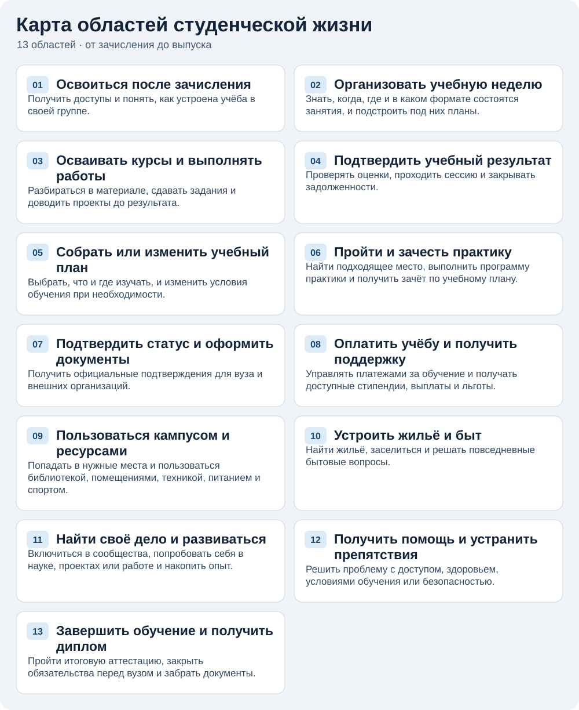

# Карта областей студенческой жизни

Карта охватывает очный бакалавриат российского вуза от первых недель после зачисления до выпуска.

[Открыть SVG в полном размере](areas.svg) · [Каталог процессов](processes.md) · [Основания карты](sources.md)

Примеры ниже — исследовательские гипотезы. Публичные материалы описывают отдельные практики вузов.

## 1. Освоиться после зачисления

Получить доступы и понять, как устроена учёба в своей группе. [Все процессы области](processes.md#area-01).

Пример — активировать университетские доступы

**Когда.** По периоду · первые недели.

Активировать университетский аккаунт, настроить почту и проверить вход в личный кабинет и систему курсов **[набор сервисов зависит от вуза]**. Если доступ не работает → **12**.

[Карточка процесса](processes.md#process-01-01).

## 2. Организовать учебную неделю

Знать, когда, где и в каком формате состоятся занятия, и подстроить под них планы. [Все процессы области](processes.md#area-02).

Пример — скорректировать планы после переноса

**Когда.** По ситуации.

Получить сообщение о переносе → сверить новое время и место с расписанием или ответственным за занятие → скорректировать планы.

[Карточка процесса](processes.md#process-02-03).

## 3. Осваивать курсы и выполнять работы

Разбираться в материале, сдавать задания и доводить проекты до результата. [Все процессы области](processes.md#area-03).

Пример — сдать и доработать учебную работу

**Когда.** Регулярно.

Выполнить и сдать работу в нужном формате → проверить, что её приняли → разобрать комментарии и доработать, если это предусмотрено.

[Карточка процесса](processes.md#process-03-05).

## 4. Подтвердить учебный результат

Проверять оценки, проходить сессию и закрывать задолженности. [Все процессы области](processes.md#area-04).

Пример — подготовиться к сессии

**Когда.** По периоду · перед сессией.

Проверить условия допуска, даты и форматы зачётов и экзаменов, закрыть недостающие работы и составить план подготовки.

[Карточка процесса](processes.md#process-04-02).

## 5. Собрать или изменить учебный план

Выбрать, что и где изучать, и изменить условия обучения при необходимости. [Все процессы области](processes.md#area-05).

Пример — выбрать дисциплины или профиль

**Когда.** По периоду · окно выбора.

Сравнить дисциплины, профили и факультативы по содержанию, требованиям и нагрузке → подать выбор → проверить, что он учтён в плане и расписании **[набор вариантов зависит от программы]**. [Выбор дисциплин в НИУ ВШЭ](https://electives.hse.ru/sw/)

[Карточка процесса](processes.md#process-05-01).

## 6. Пройти и зачесть практику

Найти подходящее место, выполнить программу практики и получить зачёт по учебному плану. [Все процессы области](processes.md#area-06).

Пример — найти и согласовать место практики

**Когда.** По периоду · до практики.

Выбрать место из предложенных вузом или найти организацию самостоятельно → согласовать место, руководителя и задание.

[Карточка процесса](processes.md#process-06-02).

## 7. Подтвердить статус и оформить документы

Получить официальные подтверждения для вуза и внешних организаций. [Все процессы области](processes.md#area-07).

Пример — получить справку или выписку

**Когда.** По ситуации.

Получить запрос от работодателя или ведомства → заказать справку об обучении или документ с результатами учёбы → забрать, скачать или передать получателю.

[Карточка процесса](processes.md#process-07-01).

## 8. Оплатить учёбу и получить поддержку

Управлять платежами за обучение и получать доступные стипендии, выплаты и льготы. [Все процессы области](processes.md#area-08).

Пример — оплатить обучение

**Когда.** По периоду · по графику договора.

Проверить сумму, срок и реквизиты → оплатить обучение через банк или доступный сервис → убедиться, что платёж учтён **[для платного обучения]**.

[Карточка процесса](processes.md#process-08-01).

## 9. Пользоваться кампусом и ресурсами

Попадать в нужные места и пользоваться библиотекой, помещениями, техникой, питанием и спортом. [Все процессы области](processes.md#area-09).

Пример — воспользоваться библиотекой

**Когда.** Регулярно.

Найти книгу или статью через библиотечный каталог → взять экземпляр или открыть электронный ресурс → при необходимости продлить или вернуть книгу.

[Карточка процесса](processes.md#process-09-03).

## 10. Устроить жильё и быт

Найти жильё, заселиться и решать повседневные бытовые вопросы. [Все процессы области](processes.md#area-10).

Пример — оформить заселение в общежитие

**Когда.** По периоду · заселение.

Подать заявку и документы → получить решение → согласовать дату заселения → оформить проживание и получить ключи. [Заселение в общежития ИТМО](https://student.itmo.ru/ru/campus/dorms_and_aparts/booking)

[Карточка процесса](processes.md#process-10-02).

## 11. Найти своё дело и развиваться

Включиться в сообщества, попробовать себя в науке, проектах или работе и накопить опыт. [Все процессы области](processes.md#area-11).

Пример — присоединиться к сообществу

**Когда.** Регулярно или по ситуации.

Найти клуб, команду или сообщество через каталог, соцсети или знакомых → прийти на встречу → присоединиться **[набор сообществ зависит от вуза]**.

[Карточка процесса](processes.md#process-11-01).

## 12. Получить помощь и устранить препятствия

Решить проблему с доступом, здоровьем, условиями обучения или безопасностью. [Все процессы области](processes.md#area-12).

Пример — восстановить технический доступ

**Когда.** По ситуации.

Потерять доступ к аккаунту, почте, Wi‑Fi или системе курсов → обратиться в техподдержку → восстановить доступ или получить рабочий обходной вариант.

[Карточка процесса](processes.md#process-12-02).

## 13. Завершить обучение и получить диплом

Пройти итоговую аттестацию, закрыть обязательства перед вузом и забрать документы. [Все процессы области](processes.md#area-13).

Пример — получить диплом и документы

**Когда.** По периоду · выпуск.

Получить диплом и приложение, забрать ранее переданные оригиналы, если они хранятся в вузе, и получить дополнительные выпускные документы при необходимости **[порядок зависит от вуза]**.

[Карточка процесса](processes.md#process-13-06).

