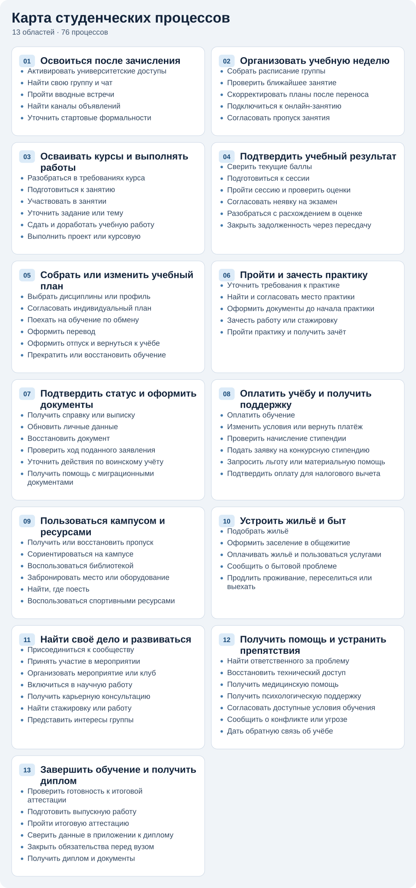

# Каталог студенческих процессов

[Карта областей](map.md) · [Сквозные сценарии](cross-area-scenarios.md) · [Основания карты](sources.md) · [Протокол разбора LMS ЦУ](../02-cu-lms-review/README.md) · [Сводка выводов](../findings.md) · [Вопросы для проверки](research-questions.md)

[Открыть SVG в полном размере](processes.svg)

В каталоге 76 процессов из исходной карты. В карточках описаны действия студента от ситуации до результата. Маршруты, каналы и затруднения предстоит проверить наблюдениями и интервью. Ссылки на практики отдельных вузов дают примеры для сравнения.

## 1. Освоиться после зачисления

Получить доступы и понять, как устроена учёба в своей группе.

01-01 · Активировать университетские доступы

По периоду · первые недели.

После зачисления нужно начать пользоваться университетскими сервисами.

**Применимость.** Набор сервисов зависит от вуза.

**Предполагаемый маршрут**

| Шаг | Что делает студент | Система или канал | Возможное затруднение |
| --- | --- | --- | --- |
| Найти инструкцию | Уточняет, как получить учётную запись и выполнить первый вход. | Письмо, памятка первокурсника. | Ссылка на активацию теряется среди вводных сообщений. |
| Активировать аккаунт | Активирует учётную запись и настраивает университетскую почту. | Страница активации, университетская почта. | В разных сервисах могут требоваться разные данные для входа. |
| Проверить доступы | Пробует войти в кабинет и систему курсов. При сбое ищет помощь. | Личный кабинет, LMS, техподдержка. | Контакт поддержки может оказаться внутри сервиса, в который не получается войти. |

**Результат.** Студент входит в почту, личный кабинет и систему курсов, если они предусмотрены.

**Связанные процессы и области.** [12. Получить помощь и устранить препятствия](#area-12).

**Основание.** Маршрут опирается на исходную карту. Детализация шагов, каналы и затруднения — гипотезы для проверки.

[Вопросы для интервью и проверки в вузах](research-questions.md#process-01-01)

01-02 · Найти свою группу и чат

По периоду · первые недели.

В первые недели нужно найти одногруппников и канал для повседневных договорённостей.

**Предполагаемый маршрут**

| Шаг | Что делает студент | Система или канал | Возможное затруднение |
| --- | --- | --- | --- |
| Узнать группу | Проверяет, к какой группе его отнесли. | Личный кабинет, приветственное письмо или сообщение вуза. | Номер группы может отличаться в разных списках. |
| Найти контакт | Ищет старосту и актуальную ссылку на чат своей группы. | Сообщение куратора, каталог групп, знакомые. | В списке может быть устаревшая ссылка или несколько похожих чатов. |
| Присоединиться | Вступает в чат и проверяет, что это чат нужной группы. | Мессенджер. | По названию чата может быть трудно узнать программу или год набора. |

**Результат.** Студент знает свою группу и может связаться со старостой и одногруппниками.

**Основание.** Маршрут опирается на исходную карту. Детализация шагов, каналы и затруднения — гипотезы для проверки.

[Вопросы для интервью и проверки в вузах](research-questions.md#process-01-02)

01-03 · Пройти вводные встречи

По периоду · первые недели.

После зачисления нужно разобраться, как устроена учёба и к кому обращаться с разными вопросами.

**Применимость.** Зависит от вуза.

**Предполагаемый маршрут**

| Шаг | Что делает студент | Система или канал | Возможное затруднение |
| --- | --- | --- | --- |
| Найти вводные встречи | Сверяет темы, даты и формат встреч для своей программы. | Письмо, календарь или страница для первокурсников. | Общевузовские встречи могут смешиваться со встречами факультета. |
| Пройти вводные | Приходит или подключается, задаёт вопросы по учебным и бытовым делам. | Аудитория, видеовстреча, материалы вводной. | После встречи может быть сложно найти нужный ответ в записи. |
| Сохранить контакты | Отмечает, кто помогает по учебным, административным и бытовым вопросам. Знакомится с куратором или наставником, если он есть. | Памятка, справочник, чат группы. | По названию роли может быть непонятно, с каким вопросом обращаться. |

**Результат.** Студент знает порядок старта и может найти контакт по конкретной теме.

**Основание.** Маршрут опирается на исходную карту. Детализация шагов, каналы и затруднения — гипотезы для проверки.

[Вопросы для интервью и проверки в вузах](research-questions.md#process-01-03)

01-04 · Найти каналы объявлений

По периоду · первые недели.

На старте нужно понять, где искать официальные объявления и срочные изменения.

**Предполагаемый маршрут**

| Шаг | Что делает студент | Система или канал | Возможное затруднение |
| --- | --- | --- | --- |
| Найти каналы | Проверяет, где публикуются объявления для вуза, программы и группы. | Кабинет, почта, LMS, чат. | В нескольких каналах может повторяться только часть объявлений. |
| Отличить официальное сообщение | Сверяет отправителя, дату и применимость объявления к своей группе. | Лента объявлений, письмо, расписание. | Пересланное сообщение может потерять дату или источник. |
| Настроить привычный просмотр | Сохраняет нужные каналы и обращается к ним при планировании недели. | Уведомления, закладки, расписание. | Срочные изменения могут затеряться среди общих новостей. |

**Результат.** Студент знает, где проверить объявление и какой канал отслеживать перед занятием.

**Связанные процессы и области.** [2. Организовать учебную неделю](#area-02).

**Основание.** Маршрут опирается на исходную карту. Детализация шагов, каналы и затруднения — гипотезы для проверки.

[Вопросы для интервью и проверки в вузах](research-questions.md#process-01-04)

01-05 · Уточнить стартовые формальности

По периоду · первые недели.

В первые недели нужно разобраться, какие формальности применимы к ситуации студента.

**Предполагаемый маршрут**

| Шаг | Что делает студент | Система или канал | Возможное затруднение |
| --- | --- | --- | --- |
| Проверить список | Сверяет стартовые инструкции по пропуску, жилью и выплатам. | Памятка первокурсника, личный кабинет, студенческий офис. | Общий список может включать действия, которые применимы лишь к части студентов. |
| Уточнить применимость | Отмечает нужные шаги и уточняет документы и сроки. | Инструкции вуза, обращение за консультацией. | Сроки разных процедур могут быть разбросаны по страницам. |
| Перейти к оформлению | При необходимости начинает оформлять пропуск, жильё или передачу реквизитов. | Страница нужной услуги, кабинет или очное обращение. | Из памятки может быть трудно перейти сразу к нужной форме. |

**Результат.** Студент знает, какие действия ему предстоят, в какие сроки и куда перейти для каждого.

**Связанные процессы и области.** [9. Пользоваться кампусом и ресурсами](#area-09) · [10. Устроить жильё и быт](#area-10) · [8. Оплатить учёбу и получить поддержку](#area-08).

**Основание.** Маршрут опирается на исходную карту. Детализация шагов, каналы и затруднения — гипотезы для проверки. [Контакты и студенческие сервисы ИТМО](https://student.itmo.ru/ru/contacts).

[Вопросы для интервью и проверки в вузах](research-questions.md#process-01-05)

## 2. Организовать учебную неделю

Знать, когда, где и в каком формате состоятся занятия, и подстроить под них планы.

02-01 · Собрать расписание группы

По периоду · начало семестра.

Перед началом занятий студент собирает расписание своей группы и подгруппы.

**Предполагаемый маршрут**

| Шаг | Что делает студент | Система или канал | Возможное затруднение |
| --- | --- | --- | --- |
| Найти расписание | Выбирает группу и подгруппу, сверяет даты начала занятий. | Сервис расписания, памятка группы. | Расписание группы может включать занятия другой подгруппы. |
| Проверить повторения | Сверяет недели, исключения и формат занятий. | Расписание на неделю, учебный календарь. | Чередующиеся недели легко принять за еженедельные занятия. |
| Перенести в планы | При необходимости добавляет повторяющиеся пары в личный календарь. | Личный календарь, экспорт расписания при наличии. | Ручная копия может устареть после изменения расписания. |

**Результат.** Первый учебный день и регулярные занятия внесены в планы студента.

**Основание.** Маршрут опирается на исходную карту. Детализация шагов, каналы и затруднения — гипотезы для проверки.

[Вопросы для интервью и проверки в вузах](research-questions.md#process-02-01)

02-02 · Проверить ближайшее занятие

Регулярно.

Перед парой или переходом между корпусами студент уточняет сведения о ближайшем занятии.

**Предполагаемый маршрут**

| Шаг | Что делает студент | Система или канал | Возможное затруднение |
| --- | --- | --- | --- |
| Найти нужную пару | Открывает расписание и проверяет ближайшее занятие своей группы. | Сервис расписания, личный кабинет. | Может быть выбрана другая дата или подгруппа. |
| Сверить детали | Проверяет время, корпус, аудиторию и формат занятия. | Карточка занятия, расписание на день. | Код корпуса или аудитории может быть непонятен. |
| Спланировать переход | При необходимости ищет корпус или вход и рассчитывает время дороги. | Карта кампуса, навигатор, указатели. | Переход между корпусами может занять больше времени, чем кажется по расписанию. |

**Результат.** Студент знает время, формат и место ближайшей пары и может спланировать дорогу.

**Основание.** Маршрут опирается на исходную карту. Детализация шагов, каналы и затруднения — гипотезы для проверки.

[Вопросы для интервью и проверки в вузах](research-questions.md#process-02-02)

02-03 · Скорректировать планы после переноса

По ситуации.

У занятия меняется время, аудитория или формат. Студенту нужно понять, касается ли перенос его группы, и успеть скорректировать планы.

**Предполагаемый маршрут**

| Шаг | Что делает студент | Система или канал | Возможное затруднение |
| --- | --- | --- | --- |
| Узнать о переносе | Замечает сообщение или изменение в расписании. | Кабинет, почта или чат группы. | Из сообщения может быть непонятно, какой группы или пары касается перенос. |
| Сверить новые данные | Проверяет актуальное время, аудиторию или ссылку на онлайн-занятие. При необходимости уточняет информацию. | Расписание, сообщение о переносе, переписка. | В сообщении уже указана новая аудитория, а в расписании ещё стоит прежняя. |
| Скорректировать планы | Решает, когда выйти, куда идти или как подключиться. При необходимости обновляет личный календарь. | Личный календарь, если студент им пользуется. |  |

**Результат.** Студент знает актуальное время и место занятия или способ подключения и успевает изменить планы.

**Основание.** Маршрут опирается на исходную карту. Детализация шагов, каналы и затруднения — гипотезы для проверки.

[Вопросы для интервью и проверки в вузах](research-questions.md#process-02-03)

02-04 · Подключиться к онлайн-занятию

Регулярно или по ситуации.

Для ближайшего онлайн-занятия студенту нужна рабочая ссылка.

**Применимость.** Если предусмотрен онлайн-формат.

**Предполагаемый маршрут**

| Шаг | Что делает студент | Система или канал | Возможное затруднение |
| --- | --- | --- | --- |
| Найти ссылку | Ищет ссылку по дисциплине, дате и группе. | Система курсов, письмо, чат. | Ссылка на предыдущую встречу может выглядеть так же, как актуальная. |
| Проверить вход | Открывает ссылку, при необходимости входит с университетской учётной записью. | Платформа видеовстреч, университетский аккаунт. | Ссылка может требовать другой аккаунт или запрашивать разрешение. |
| Подключиться | Заходит к началу пары или ищет помощь при ошибке входа. | Видеовстреча, чат курса. | Пока выясняется причина, студент может пропустить начало. |

**Результат.** Студент подключается к нужному занятию с подходящей учётной записью.

**Основание.** Маршрут опирается на исходную карту. Детализация шагов, каналы и затруднения — гипотезы для проверки.

[Вопросы для интервью и проверки в вузах](research-questions.md#process-02-04)

02-05 · Согласовать пропуск занятия

По ситуации.

Студент понимает, что занятие совпадает с другим обязательством или его придётся пропустить.

**Предполагаемый маршрут**

| Шаг | Что делает студент | Система или канал | Возможное затруднение |
| --- | --- | --- | --- |
| Уточнить порядок | Проверяет правила курса и выясняет, к кому обращаться по пропуску. | Программа курса, памятка, контакт преподавателя. | Правила могут различаться между дисциплинами. |
| Сообщить о пропуске | Предупреждает нужного человека и при необходимости согласует пропуск. | Почта, чат курса, форма обращения. | Может быть непонятно, достаточно ли сообщения в чате. |
| Договориться о следующих шагах | Уточняет, какие материалы изучить и какие задания выполнить после пропуска. | LMS, консультация, переписка. | Задание для пропустивших может быть не видно в общем списке. |

**Результат.** Студент знает, кого предупредить, и понимает, как наверстать материал.

**Связанные процессы и области.** [3. Осваивать курсы и выполнять работы](#area-03) · [4. Подтвердить учебный результат](#area-04).

**Основание.** Маршрут опирается на исходную карту. Детализация шагов, каналы и затруднения — гипотезы для проверки.

[Вопросы для интервью и проверки в вузах](research-questions.md#process-02-05)

## 3. Осваивать курсы и выполнять работы

Разбираться в материале, сдавать задания и доводить проекты до результата.

03-01 · Разобраться в требованиях курса

По периоду · начало курса.

В начале курса студенту нужно понять, как распределить нагрузку и что влияет на результат.

**Предполагаемый маршрут**

| Шаг | Что делает студент | Система или канал | Возможное затруднение |
| --- | --- | --- | --- |
| Найти программу | Открывает актуальную программу курса и календарь работ. | LMS, страница дисциплины, вводные материалы. | На разных страницах могут быть версии программы разных лет. |
| Разобрать требования | Сверяет обязательные работы, веса и критерии оценивания. | Программа, критерии курса. | Критерии отдельного задания могут быть описаны отдельно от правил итоговой оценки. |
| Спланировать нагрузку | Отмечает ключевые даты и уточняет непонятные условия. | Календарь заданий, личный план, канал курса. | Сроки могут меняться в конкретном задании без обновления общей программы. |

**Результат.** Студент знает обязательные работы, ближайшие сроки и правила оценки.

**Основание.** Маршрут опирается на исходную карту. Детализация шагов, каналы и затруднения — гипотезы для проверки.

[Вопросы для интервью и проверки в вузах](research-questions.md#process-03-01)

03-02 · Подготовиться к занятию

Регулярно.

Перед парой студенту нужно найти и освоить материалы или сделать подготовительную работу.

**Предполагаемый маршрут**

| Шаг | Что делает студент | Система или канал | Возможное затруднение |
| --- | --- | --- | --- |
| Найти подготовку | Сверяет тему ближайшей пары и список материалов и заданий. | LMS, письмо или чат курса. | Обязательные материалы могут смешиваться с дополнительными. |
| Открыть материалы | Находит нужное издание или файл, при необходимости обращается к библиотеке. | Система курсов, библиотечный каталог, ссылки из курса. | Ссылка может требовать отдельного доступа или вести на другую редакцию. |
| Подготовиться | Читает обязательное и выполняет подготовительные задания. | Материалы курса, рабочая тетрадь или форма задания. | Может быть неясно, нужно ли заранее сдавать результат подготовки. |

**Результат.** К занятию прочитаны нужные материалы и выполнены подготовительные задания.

**Связанные процессы и области.** [9. Пользоваться кампусом и ресурсами](#area-09).

**Основание.** Маршрут опирается на исходную карту. Детализация шагов, каналы и затруднения — гипотезы для проверки.

[Вопросы для интервью и проверки в вузах](research-questions.md#process-03-02)

03-03 · Участвовать в занятии

Регулярно.

В расписании есть лекция, семинар или лабораторная работа.

**Предполагаемый маршрут**

| Шаг | Что делает студент | Система или канал | Возможное затруднение |
| --- | --- | --- | --- |
| Присоединиться к занятию | Приходит в нужную аудиторию или подключается онлайн. | Кампус, видеовстреча. |  |
| Участвовать | Следит за материалом, задаёт вопросы и участвует в обсуждении по формату пары. | Занятие, чат встречи, учебные материалы. | У онлайн-участника может быть неудобный канал для вопросов. |
| Выполнить работу на паре | Открывает нужное задание, выполняет его и при необходимости сдаёт результат. | Рабочее место, лаборатория, LMS. | Ссылка на задание может быть доступна только в устном объявлении или чате. |

**Результат.** Студент участвует в занятии и выполняет предусмотренную работу.

**Основание.** Маршрут опирается на исходную карту. Детализация шагов, каналы и затруднения — гипотезы для проверки.

[Вопросы для интервью и проверки в вузах](research-questions.md#process-03-03)

03-04 · Уточнить задание или тему

Регулярно.

Студенту непонятно условие задания или учебная тема.

**Предполагаемый маршрут**

| Шаг | Что делает студент | Система или канал | Возможное затруднение |
| --- | --- | --- | --- |
| Сформулировать вопрос | Сверяет условие и материалы курса, выделяет конкретный непонятный момент. | Карточка задания, программа, записи занятия. | Разные версии задания могут создавать разные трактовки. |
| Выбрать канал | Задаёт вопрос преподавателю или ассистенту на паре, консультации, по почте или в чате. | Занятие, консультация, почта, чат курса. | Может быть неясно, где задать вопрос, чтобы получить ответ до дедлайна. |
| Применить ответ | Сверяет своё понимание и использует пояснение в работе. | Переписка, заметки, материалы задания. | Важное уточнение может остаться в длинной переписке. |

**Результат.** Студент получил ответ, с которым может продолжить работу или разобраться в теме.

**Основание.** Маршрут опирается на исходную карту. Детализация шагов, каналы и затруднения — гипотезы для проверки.

[Вопросы для интервью и проверки в вузах](research-questions.md#process-03-04)

03-05 · Сдать и доработать учебную работу

Регулярно.

По курсу нужно сдать работу и при необходимости её доработать.

**Предполагаемый маршрут**

| Шаг | Что делает студент | Система или канал | Возможное затруднение |
| --- | --- | --- | --- |
| Подготовить работу | Проверяет требования к содержанию, формату и сроку, готовит файл или ссылку. | Карточка задания, материалы курса. | Условие и форма сдачи могут указывать разные форматы. |
| Отправить и сверить приём | Сдаёт работу и проверяет, какая версия принята. | LMS, репозиторий, форма или почта по правилам курса. | Загрузка файла может выглядеть успешной без подтверждения сдачи. |
| Разобрать комментарии | Открывает обратную связь и уточняет срок и способ повторной сдачи, если доработка предусмотрена. | Карточка работы, журнал, переписка. | Комментарии могут быть в другом сервисе, чем сама сдача. |
| Отправить доработку | Исправляет работу, повторно сдаёт её и проверяет итоговый статус. | Канал повторной сдачи. | Может быть непонятно, какая версия считается последней. |

**Результат.** Работа принята, а при требуемой доработке студент отправил исправленный вариант и проверил его приём.

**Основание.** Маршрут опирается на исходную карту. Детализация шагов, каналы и затруднения — гипотезы для проверки.

[Вопросы для интервью и проверки в вузах](research-questions.md#process-03-05)

03-06 · Выполнить проект или курсовую

По периоду · этап проекта или курсовой.

На курсе предстоит проект или курсовая работа.

**Применимость.** По программе.

**Предполагаемый маршрут**

| Шаг | Что делает студент | Система или канал | Возможное затруднение |
| --- | --- | --- | --- |
| Определить тему и участников | Выбирает тему и руководителя или собирает команду, если этого требует программа. | Каталог тем, курс, переписка. | Свободные темы или доступность руководителей могут быть неизвестны. |
| Спланировать работу | Распределяет задачи и согласует этапы и сроки. | Документ проекта, таск-трекер, консультация. | Границы ответственности могут расходиться с критериями оценивания. |
| Сверить прогресс | Представляет промежуточный результат, учитывает замечания. | Консультация, LMS, рабочие документы. | Из замечаний может быть непонятно, что обязательно исправить к защите. |
| Представить итог | Готовит итоговый материал и сдаёт или представляет его по требованиям курса. | Форма сдачи, защита, презентация. | Требования к файлам и представлению могут быть описаны в разных местах. |

**Результат.** Тема и формат участия согласованы, промежуточная работа выполнена, итог представлен.

**Основание.** Маршрут опирается на исходную карту. Детализация шагов, каналы и затруднения — гипотезы для проверки. [Руководство курсовыми работами в НИУ ВШЭ](https://www.hse.ru/studyspravka/krvkrruk).

[Вопросы для интервью и проверки в вузах](research-questions.md#process-03-06)

## 4. Подтвердить учебный результат

Проверять оценки, проходить сессию и закрывать задолженности.

04-01 · Сверить текущие баллы

Регулярно.

В течение курса студент сверяет, сколько баллов набрано и что ещё влияет на результат.

**Предполагаемый маршрут**

| Шаг | Что делает студент | Система или канал | Возможное затруднение |
| --- | --- | --- | --- |
| Открыть результаты | Находит баллы и статусы по выполненным работам. | Журнал оценок, карточки заданий. | Пустая ячейка может означать ожидание проверки, пропуск или отсутствие оценки. |
| Сверить правила | Сопоставляет результаты с весами и обязательными элементами курса. | Программа, журнал, критерии. | Журнал может показывать баллы без объяснения их вклада в итог. |
| Определить остаток | Выясняет, какие работы или проверки ещё предстоят, и при необходимости уточняет расхождения. | LMS, календарь курса, переписка. | Общий балл может скрывать отдельное обязательное задание. |

**Результат.** Студент понимает текущий результат и перечень оставшихся элементов контроля.

**Основание.** Маршрут опирается на исходную карту. Детализация шагов, каналы и затруднения — гипотезы для проверки.

[Вопросы для интервью и проверки в вузах](research-questions.md#process-04-01)

04-02 · Подготовиться к сессии

По периоду · перед сессией.

Перед сессией студенту нужно проверить допуск, закрыть оставшиеся требования и распределить подготовку.

**Предполагаемый маршрут**

| Шаг | Что делает студент | Система или канал | Возможное затруднение |
| --- | --- | --- | --- |
| Проверить допуск | Сверяет условия допуска с текущими результатами. | Программа, журнал оценок, раздел сессии. | Требования могут быть рассеяны по нескольким разделам. |
| Закрыть недостающее | Выясняет, какие работы можно выполнить или досдать, и проверяет их учёт. | Карточки заданий, консультация, журнал. | Сданная работа может ещё не отражаться в статусе допуска. |
| Составить план | Сверяет даты и форматы зачётов и экзаменов и распределяет время. | Расписание сессии, личный календарь. | Дата экзамена может появиться позже сведений о допуске. |

**Результат.** Студент знает свой допуск, даты и форматы испытаний и план подготовки.

**Основание.** Маршрут опирается на исходную карту. Детализация шагов, каналы и затруднения — гипотезы для проверки.

[Вопросы для интервью и проверки в вузах](research-questions.md#process-04-02)

04-03 · Пройти сессию и проверить оценки

По периоду · сессия.

Во время сессии студент проходит зачёты и экзамены и сверяет итоги.

**Предполагаемый маршрут**

| Шаг | Что делает студент | Система или канал | Возможное затруднение |
| --- | --- | --- | --- |
| Проверить условия испытания | Сверяет дату, формат и необходимые материалы или документы. | Расписание сессии, инструкция дисциплины. | Детали экзамена могут уточняться в отдельном канале. |
| Пройти испытание | Приходит или подключается и сдаёт зачёт либо экзамен. | Аудитория, платформа экзамена. |  |
| Проверить итог | Находит итоговую оценку или зачёт в официальной ведомости или кабинете. | Ведомость, личный кабинет. | Предварительный балл и официальная оценка могут появляться в разное время. |

**Результат.** Студент прошёл испытания и увидел итоговые результаты в официальном источнике.

**Основание.** Маршрут опирается на исходную карту. Детализация шагов, каналы и затруднения — гипотезы для проверки.

[Вопросы для интервью и проверки в вузах](research-questions.md#process-04-03)

04-04 · Согласовать неявку на экзамен

По ситуации.

Болезнь или другое обстоятельство мешает явиться на экзамен.

**Предполагаемый маршрут**

| Шаг | Что делает студент | Система или канал | Возможное затруднение |
| --- | --- | --- | --- |
| Уточнить порядок | Проверяет, кого и в какой срок нужно уведомить. | Инструкции по сессии, контакты учебного офиса. | Нужный порядок может быть трудно найти в ситуации ограниченного времени. |
| Уведомить | Сообщает о неявке и передаёт подтверждение, если оно требуется. | Форма, почта или обращение по принятому порядку. | Может быть непонятно, получили ли сообщение и документы. |
| Узнать следующий шаг | Проверяет решение и уточняет новую дату или дальнейшие действия. | Кабинет, ответ на обращение, расписание. | Решение и дата могут появиться в разных местах. |

**Результат.** Студент знает решение по неявке и новую дату, если она назначена.

**Основание.** Маршрут опирается на исходную карту. Детализация шагов, каналы и затруднения — гипотезы для проверки.

[Вопросы для интервью и проверки в вузах](research-questions.md#process-04-04)

04-05 · Разобраться с расхождением в оценке

По ситуации.

Студент замечает, что ожидаемая и опубликованная оценки расходятся.

**Предполагаемый маршрут**

| Шаг | Что делает студент | Система или канал | Возможное затруднение |
| --- | --- | --- | --- |
| Сверить расхождение | Сопоставляет оценки, критерии и комментарии по конкретной работе. | Журнал, ведомость, карточка задания. | У источников могут быть разные шкалы или уровни итогов. |
| Запросить разъяснение | Обращается к ответственному с указанием конкретного расхождения. | Почта, консультация, обращение. | Может быть неясно, к кому идти при расхождении между журналом и ведомостью. |
| Проверить результат | Узнаёт итог проверки, а при необходимости и применимости подаёт апелляцию и отслеживает её исход. | Кабинет, переписка, официальная процедура. | Исправление записи может обновиться не во всех представлениях одновременно. |

**Результат.** Студент получил разъяснение или результат проверки и понимает, какая оценка применяется.

**Основание.** Маршрут опирается на исходную карту. Детализация шагов, каналы и затруднения — гипотезы для проверки.

[Вопросы для интервью и проверки в вузах](research-questions.md#process-04-05)

04-06 · Закрыть задолженность через пересдачу

По ситуации · период пересдач.

Студенту нужно закрыть задолженность через пересдачу.

**Предполагаемый маршрут**

| Шаг | Что делает студент | Система или канал | Возможное затруднение |
| --- | --- | --- | --- |
| Уточнить правила и долг | Сверяет дисциплину, условия допуска и порядок пересдачи. | Ведомость, правила аттестации, учебный офис. | Причина задолженности и способ закрытия могут находиться в разных местах. |
| Уточнить дату | Проверяет назначенную дату или согласует её в принятом порядке. | Расписание пересдач, обращение, переписка. | Дата может быть опубликована отдельно от списка задолженностей. |
| Пересдать и проверить результат | Проходит пересдачу и сверяет новый результат и состояние долга. | Аудитория или платформа экзамена, ведомость. | Новая оценка может быть доступна раньше обновления статуса задолженности. |

**Результат.** Результат пересдачи учтён, студент проверил состояние задолженности.

**Основание.** Маршрут опирается на исходную карту. Детализация шагов, каналы и затруднения — гипотезы для проверки. [Аттестация и пересдачи в НИУ ВШЭ](https://www.hse.ru/studyspravka/new_regulations).

[Вопросы для интервью и проверки в вузах](research-questions.md#process-04-06)

## 5. Собрать или изменить учебный план

Выбрать, что и где изучать, и изменить условия обучения при необходимости.

05-01 · Выбрать дисциплины или профиль

По периоду · окно выбора.

Открылось окно выбора дисциплин, профиля или факультативов.

**Применимость.** Набор вариантов зависит от программы.

**Предполагаемый маршрут**

| Шаг | Что делает студент | Система или канал | Возможное затруднение |
| --- | --- | --- | --- |
| Сравнить варианты | Сверяет содержание, предпосылки, нагрузку и ограничения своей программы. | Каталог дисциплин, программа обучения. | Кратких описаний может не хватать, чтобы сравнить нагрузку или понять условия. |
| Подать выбор | Выбирает варианты в установленное окно и проверяет подтверждение. | Форма выбора, личный кабинет. | Отправка формы может не означать, что место окончательно закреплено. |
| Проверить учёт | Сверяет результат выбора с учебным планом и расписанием. | Личный кабинет, учебный план, расписание. | В плане и расписании результат может появиться в разное время. |

**Результат.** Студент подал выбор и проверил, что он учтён в плане и расписании.

**Основание.** Маршрут опирается на исходную карту. Детализация шагов, каналы и затруднения — гипотезы для проверки. [Выбор дисциплин в НИУ ВШЭ](https://electives.hse.ru/sw/).

[Вопросы для интервью и проверки в вузах](research-questions.md#process-05-01)

05-02 · Согласовать индивидуальный план

По ситуации.

Студенту нужно перераспределить нагрузку или изменить сроки прохождения дисциплин.

**Предполагаемый маршрут**

| Шаг | Что делает студент | Система или канал | Возможное затруднение |
| --- | --- | --- | --- |
| Разобраться в вариантах | Сверяет текущий план и формулирует, что нужно изменить. | Учебный план, консультация. | Может быть трудно оценить последствия для более поздних дисциплин. |
| Запросить изменение | Подаёт запрос на индивидуальный план и при необходимости уточняет предложенные параметры. | Форма, переписка или обращение в учебный офис. | Согласуемые изменения и текущий официальный план легко перепутать. |
| Сверить итог | Получает согласованный вариант и проверяет порядок прохождения дисциплин и сроки. | Учебный план, решение по обращению, расписание. | После согласования отдельные изменения могут быть видны не во всех разделах. |

**Результат.** Студент знает согласованный набор дисциплин, сроки и порядок прохождения.

**Основание.** Маршрут опирается на исходную карту. Детализация шагов, каналы и затруднения — гипотезы для проверки.

[Вопросы для интервью и проверки в вузах](research-questions.md#process-05-02)

05-03 · Поехать на обучение по обмену

По периоду · конкурсный отбор.

Студент хочет часть программы пройти в другом вузе по обмену.

**Применимость.** Зависит от вуза, конкурсный сценарий.

**Предполагаемый маршрут**

| Шаг | Что делает студент | Система или канал | Возможное затруднение |
| --- | --- | --- | --- |
| Проверить условия и податься | Сверяет сроки, комплект и требования программы обмена, подаёт заявку. | Портал мобильности, форма отбора. | Календарь конкурса может отличаться от календаря принимающего вуза. |
| Согласовать дисциплины | Выбирает курсы и сверяет, какие можно будет зачесть после возвращения. | Каталог принимающего вуза, план обучения, согласование. | Описания и объём курсов могут сравниваться по разным критериям. |
| Передать результаты | Получает документы о результатах и передаёт их на зачёт. | Кабинет или почта программы, документы принимающего вуза. | Может быть сложно понять, какие результаты уже учтены. |

**Результат.** Согласованы дисциплины до поездки, после возвращения студент передал результаты и проверил их учёт.

**Основание.** Маршрут опирается на исходную карту. Детализация шагов, каналы и затруднения — гипотезы для проверки. [Программы мобильности ИТМО](https://student.itmo.ru/ru/mobility/).

[Вопросы для интервью и проверки в вузах](research-questions.md#process-05-03)

05-04 · Оформить перевод

По ситуации.

Студент хочет сменить программу, вуз или основание обучения, например перейти на бюджетное место.

**Применимость.** Редкий случай.

**Предполагаемый маршрут**

| Шаг | Что делает студент | Система или канал | Возможное затруднение |
| --- | --- | --- | --- |
| Уточнить условия и доступность | Проверяет требования, наличие мест и сроки для своего вида перевода. | Правила перевода, публикация мест, консультация. | Условия перевода между программами и перехода на бюджет могут смешиваться. |
| Подать заявление | Собирает комплект и проверяет приём заявки. | Форма, почта, личное обращение. | Может быть непонятно, приложены ли все документы для выбранного вида перевода. |
| Проверить решение | Узнаёт решение и, если перевод одобрен, сверяет изменения в плане и оплате. | Кабинет, приказ, учебный план, информация по договору. | Дата начала изменений может отличаться от даты решения. |

**Результат.** Студент получил решение и понимает последствия для плана, сроков и оплаты.

**Основание.** Маршрут опирается на исходную карту. Детализация шагов, каналы и затруднения — гипотезы для проверки. [Пример порядка перевода в НИУ ВШЭ](https://www.hse.ru/studyspravka/transfer/).

[Вопросы для интервью и проверки в вузах](research-questions.md#process-05-04)

05-05 · Оформить отпуск и вернуться к учёбе

По ситуации.

Студенту нужен академический или другой применимый отпуск, затем он планирует вернуться.

**Применимость.** Редкий случай.

**Предполагаемый маршрут**

| Шаг | Что делает студент | Система или канал | Возможное затруднение |
| --- | --- | --- | --- |
| Уточнить порядок | Находит подходящий вид отпуска, сроки и документы. | Памятка, учебный офис, консультация. | Правила по разным основаниям могут выглядеть как единая процедура. |
| Подать заявление | Обращается за отпуском и проверяет итоговое решение. | Форма, кабинет, переписка. | Из решения может быть трудно понять, когда нужно начать оформление выхода. |
| Уточнить возвращение | Проверяет сроки выхода и связанные условия до окончания отпуска. | Приказ или решение, календарь, контакт учебного офиса. | Нужные сведения могут быть доступны только через аккаунт с изменившимся доступом. |
| Оформить выход | Оформляет выход из отпуска и сверяет обновлённый учебный план. | Форма выхода, кабинет, план, расписание. | Часть дисциплин и дат может быть определена только после возвращения. |

**Результат.** Студент знает условия и сроки отпуска, а при возвращении сверяет обновлённый учебный план.

**Основание.** Маршрут опирается на исходную карту. Детализация шагов, каналы и затруднения — гипотезы для проверки. [Возвращение из академического отпуска в НИУ ВШЭ](https://www.hse.ru/studyspravka/return_academ/).

[Вопросы для интервью и проверки в вузах](research-questions.md#process-05-05)

05-06 · Прекратить или восстановить обучение

По ситуации.

Студент хочет прекратить обучение по своей инициативе или вернуться после прекращения.

**Применимость.** Редкий случай.

**Предполагаемый маршрут**

| Шаг | Что делает студент | Система или канал | Возможное затруднение |
| --- | --- | --- | --- |
| Уточнить применимый порядок | Разбирается в правилах прекращения или восстановления для своей ситуации. | Справочник, консультация учебного офиса. | Сроки и требования могут различаться по основаниям и программе. |
| Подать запрос | Готовит документы и подаёт заявление на нужное действие. | Форма, переписка, очное обращение. | После потери доступа к кабинету может понадобиться другой способ подачи. |
| Узнать результат | Проверяет решение и порядок получения документов или возвращения к учёбе. | Ответ на обращение, приказ, инструкции. | В решении может отсутствовать понятный перечень следующих действий. |

**Результат.** Студент получил решение и знает, какие документы забрать или какие условия выполнить для продолжения.

**Основание.** Маршрут опирается на исходную карту. Детализация шагов, каналы и затруднения — гипотезы для проверки.

[Вопросы для интервью и проверки в вузах](research-questions.md#process-05-06)

## 6. Пройти и зачесть практику

Найти подходящее место, выполнить программу практики и получить зачёт по учебному плану.

06-01 · Уточнить требования к практике

По периоду · до практики.

Перед практикой студенту нужно знать условия её прохождения и зачёта по своей программе.

**Применимость.** По программе.

**Предполагаемый маршрут**

| Шаг | Что делает студент | Система или канал | Возможное затруднение |
| --- | --- | --- | --- |
| Найти правила программы | Сверяет вид практики, учебные даты и требования к месту. | Программа практики, учебный план, LMS. | Инструкции разных потоков могут выглядеть одинаково. |
| Уточнить результат и сроки | Проверяет, что подготовить для начала и что представить для зачёта. | Памятка практики, календарь, консультация. | Документы до начала практики и материалы итогового отчёта могут быть перечислены вместе. |

**Результат.** Студент знает сроки, допустимые места и набор результатов для зачёта.

**Основание.** Маршрут опирается на исходную карту. Детализация шагов, каналы и затруднения — гипотезы для проверки.

[Вопросы для интервью и проверки в вузах](research-questions.md#process-06-01)

06-02 · Найти и согласовать место практики

По периоду · до практики.

Студенту предстоит выбрать место практики и согласовать, как она будет проходить.

**Предполагаемый маршрут**

| Шаг | Что делает студент | Система или канал | Возможное затруднение |
| --- | --- | --- | --- |
| Найти варианты | Просматривает места вуза или ищет организацию самостоятельно. | Каталог мест, карьерный сервис, внешние объявления. | В списке может быть трудно отличить актуальные предложения от прошлогодних. |
| Сверить соответствие | Проверяет задачи, сроки и условия места по требованиям программы. | Описание места, правила практики, переписка. | Внешнее предложение может не содержать данных, необходимых для согласования. |
| Согласовать выбор | Представляет выбранные место, руководителя и задание и проверяет результат согласования. | Форма практики, почта или личный кабинет. | Может быть неясно, что согласовано и что ещё требует подтверждения. |

**Результат.** У студента согласованы место, руководитель и задание.

**Основание.** Маршрут опирается на исходную карту. Детализация шагов, каналы и затруднения — гипотезы для проверки.

[Вопросы для интервью и проверки в вузах](research-questions.md#process-06-02)

06-03 · Оформить документы до начала практики

По периоду · до начала.

Место практики выбрано, до старта нужно оформить документы.

**Предполагаемый маршрут**

| Шаг | Что делает студент | Система или канал | Возможное затруднение |
| --- | --- | --- | --- |
| Найти список и шаблоны | Уточняет, какие документы нужны вузу и принимающей организации. | Памятка, шаблоны, переписка. | Стороны могут использовать разные формы или версии шаблонов. |
| Собрать и передать комплект | Заполняет документы, собирает нужные подписи и передаёт комплект обеим сторонам. | Документы, переписка, кабинет или очная передача. | Круг подписей и очередность могут быть непонятны. |
| Проверить готовность | Убеждается, что документы приняты и начало согласовано. | Статус, ответ, контакт руководителя практики. | Наличие подписанного файла у студента может не показывать, что комплект учтён. |

**Результат.** Студент собрал нужные подписи, передал комплект и убедился, что может приступать.

**Основание.** Маршрут опирается на исходную карту. Детализация шагов, каналы и затруднения — гипотезы для проверки.

[Вопросы для интервью и проверки в вузах](research-questions.md#process-06-03)

06-04 · Зачесть работу или стажировку

По ситуации.

Студент уже работает или стажируется и хочет зачесть опыт как практику.

**Применимость.** Зависит от вуза и программы.

**Предполагаемый маршрут**

| Шаг | Что делает студент | Система или канал | Возможное затруднение |
| --- | --- | --- | --- |
| Проверить применимость | Сопоставляет свои задачи и сроки с условиями программы. | Правила практики, консультация. | Из правил может быть неясно, подходит ли текущая роль и объём работы. |
| Подать подтверждения | Запрашивает нужные документы и передаёт их на рассмотрение. | Документы организации, форма или почта вуза. | Подтверждение работодателя может не содержать сведений, нужных вузу. |
| Проверить решение | Узнаёт, засчитан ли опыт и нужны ли отчёт или другие действия. | Кабинет, переписка, правила зачёта. | Из согласования места может быть трудно понять, учтён ли итог практики. |

**Результат.** Студент получил решение о зачёте опыта и знает, что требуется дальше.

**Связанные процессы и области.** [11. Найти своё дело и развиваться](#area-11).

**Основание.** Маршрут опирается на исходную карту. Детализация шагов, каналы и затруднения — гипотезы для проверки.

[Вопросы для интервью и проверки в вузах](research-questions.md#process-06-04)

06-05 · Пройти практику и получить зачёт

По периоду · во время и после практики.

Практика началась, студенту нужно выполнить задание и закрыть зачёт.

**Предполагаемый маршрут**

| Шаг | Что делает студент | Система или канал | Возможное затруднение |
| --- | --- | --- | --- |
| Выполнить задание | Делает работу и сохраняет нужные материалы и подтверждения от руководителя. | Рабочая среда, дневник или документы практики. | В процессе может быть непонятно, какие подтверждения собирать заранее. |
| Подготовить и сдать отчёт | Собирает отчёт, передаёт его и при необходимости защищает. | Форма сдачи, LMS, защита. | У отправки отчёта и защиты могут быть разные сроки. |
| Проверить зачёт | Сверяет результат после сдачи и при необходимости уточняет недостающее. | Ведомость, личный кабинет, переписка. | Принятый отчёт может отображаться раньше зачёта в ведомости. |

**Результат.** Работа выполнена, отчёт сдан или защищён, результат учтён.

**Основание.** Маршрут опирается на исходную карту. Детализация шагов, каналы и затруднения — гипотезы для проверки. [Выбор места и прохождение практики в ИТМО](https://student.itmo.ru/ru/education/practice/place).

[Вопросы для интервью и проверки в вузах](research-questions.md#process-06-05)

## 7. Подтвердить статус и оформить документы

Получить официальные подтверждения для вуза и внешних организаций.

07-01 · Получить справку или выписку

По ситуации.

Работодатель или ведомство запрашивает подтверждение обучения или учебных результатов.

**Предполагаемый маршрут**

| Шаг | Что делает студент | Система или канал | Возможное затруднение |
| --- | --- | --- | --- |
| Уточнить документ | Сверяет, какую справку или выписку примет получатель и к какому сроку. | Запрос получателя, каталог справок. | Названия похожих справок могут не объяснять, что в них указано. |
| Заказать | Выбирает тип документа, направляет запрос и при необходимости проверяет срок выдачи. | Кабинет, форма, почта или студофис. | Срок и способ получения могут стать известны только после отправки. |
| Получить и передать | Скачивает или забирает справку, сверяет данные и передаёт получателю. | Кабинет, почта или точка выдачи. | Может понадобиться оригинал, хотя студент рассчитывал на электронную версию. |

**Результат.** Студент получил нужный документ и может передать его получателю.

**Основание.** Маршрут опирается на исходную карту. Детализация шагов, каналы и затруднения — гипотезы для проверки.

[Вопросы для интервью и проверки в вузах](research-questions.md#process-07-01)

07-02 · Обновить личные данные

По ситуации.

Изменились фамилия, паспортные данные или контакты студента.

**Предполагаемый маршрут**

| Шаг | Что делает студент | Система или канал | Возможное затруднение |
| --- | --- | --- | --- |
| Уточнить порядок изменения | Проверяет, какие сведения можно обновить и нужно ли подтверждение. | Профиль, инструкция, студенческий офис. | Смена контакта и изменение официальных данных могут требовать разных действий. |
| Передать сведения | Обновляет доступные поля или направляет подтверждение через предусмотренный канал. | Личный кабинет, форма, очное обращение. | Может быть непонятно, когда нужна отдельная заявка. |
| Проверить запись | Сверяет отображаемые данные или полученное подтверждение. | Профиль, ответ на обращение. | Записи могут обновиться в разных системах в разное время. |

**Результат.** Студент проверил, что нужная запись обновилась.

**Основание.** Маршрут опирается на исходную карту. Детализация шагов, каналы и затруднения — гипотезы для проверки.

[Вопросы для интервью и проверки в вузах](research-questions.md#process-07-02)

07-03 · Восстановить документ

По ситуации.

Потерян студенческий билет или понадобился дубликат другого документа.

**Предполагаемый маршрут**

| Шаг | Что делает студент | Система или канал | Возможное затруднение |
| --- | --- | --- | --- |
| Найти порядок восстановления | Проверяет, как называется нужная услуга, что требуется и куда обращаться. | Памятка, личный кабинет, студофис. | Восстановление документа и восстановление доступа в здание могут выглядеть как одна услуга. |
| Запросить дубликат | Подаёт заявку и передаёт нужные сведения или подтверждения. | Форма, почта, очное обращение. | Может быть неясно, что делать до готовности дубликата. |
| Получить документ | Уточняет срок, забирает или скачивает дубликат и сверяет сведения. | Пункт выдачи, кабинет, уведомление. | Уведомление о готовности может не сообщать, где забрать документ. |

**Результат.** Студент получил замену или дубликат нужного документа.

**Связанные процессы и области.** [9. Пользоваться кампусом и ресурсами](#area-09).

**Основание.** Маршрут опирается на исходную карту. Детализация шагов, каналы и затруднения — гипотезы для проверки.

[Вопросы для интервью и проверки в вузах](research-questions.md#process-07-03)

07-04 · Проверить ход поданного заявления

По ситуации.

Студент уже подал заявление и хочет понять, есть ли решение или от него ждут действий.

**Предполагаемый маршрут**

| Шаг | Что делает студент | Система или канал | Возможное затруднение |
| --- | --- | --- | --- |
| Найти поданное заявление | Проверяет, принято ли обращение и на каком оно этапе. | История обращений, почта или канал подачи. | Подтверждение отправки может не объяснять, начато ли рассмотрение. |
| Донести документ | Если поступил запрос, уточняет, что добавить, передаёт документ и проверяет приём. | Кабинет, переписка или форма дополнения. | После отправки может быть непонятно, принят ли новый файл. |
| Получить решение | Проверяет итог и при необходимости получает копию приказа. | Карточка заявления, официальный ответ, очная выдача. | Итоговый статус может быть виден отдельно от самого решения. |

**Результат.** Студент знает актуальный статус, выполнил требуемый шаг и получил решение или копию приказа, если нужна.

**Связанные процессы и области.** [5. Собрать или изменить учебный план](#area-05) · [8. Оплатить учёбу и получить поддержку](#area-08).

**Основание.** Маршрут опирается на исходную карту. Детализация шагов, каналы и затруднения — гипотезы для проверки.

[Вопросы для интервью и проверки в вузах](research-questions.md#process-07-04)

07-05 · Уточнить действия по воинскому учёту

По периоду или по ситуации.

Студенту, которого касается воинский учёт, нужно уточнить порядок действий или получить подтверждение.

**Применимость.** Для тех, кого это касается.

**Предполагаемый маршрут**

| Шаг | Что делает студент | Система или канал | Возможное затруднение |
| --- | --- | --- | --- |
| Найти актуальный порядок | Уточняет, куда обратиться и какие сведения нужно подготовить для своего случая. | Официальная инструкция вуза, профильное подразделение. | Общая памятка может не объяснять, какой маршрут относится к конкретной ситуации. |
| Обратиться и сверить результат | Задаёт вопрос или запрашивает подтверждение и проверяет, какие действия ещё нужны. | Установленный вузом канал обращения, официальная консультация. | Порядок и нужный документ могут выясниться только после обращения. |

**Результат.** Студент знает применимые действия и получил нужное подтверждение, если оно требовалось.

**Основание.** Маршрут опирается на исходную карту. Детализация шагов, каналы и затруднения — гипотезы для проверки. [Вопросы воинского учёта в НИУ ВШЭ](https://www.hse.ru/vtotd/faq).

[Вопросы для интервью и проверки в вузах](research-questions.md#process-07-05)

07-06 · Получить помощь с миграционными документами

По периоду или по ситуации.

Иностранному студенту нужна помощь с документами при заселении, смене адреса или продлении пребывания.

**Применимость.** Для иностранных студентов, по применимости.

**Предполагаемый маршрут**

| Шаг | Что делает студент | Система или канал | Возможное затруднение |
| --- | --- | --- | --- |
| Уточнить маршрут | Проверяет, какая инструкция относится к его ситуации и где получить разъяснение. | Официальная памятка, подразделение по работе с иностранными студентами. | Инструкции для разных ситуаций могут выглядеть одинаково. |
| Обратиться за сопровождением | Описывает ситуацию через подходящий канал и передаёт требуемый комплект по инструкции. | Запись на приём, защищённая форма или очное обращение. | Могут понадобиться объяснения на понятном студенту языке. |
| Проверить следующий шаг | Уточняет, что уже оформлено и какие действия или подтверждения ещё нужны. | Ответ на обращение, официальные документы. | После передачи комплекта студент может не видеть срок или статус. |

**Результат.** Студент знает свой следующий шаг, применимые сроки и куда передать документы.

**Основание.** Маршрут опирается на исходную карту. Детализация шагов, каналы и затруднения — гипотезы для проверки.

[Вопросы для интервью и проверки в вузах](research-questions.md#process-07-06)

## 8. Оплатить учёбу и получить поддержку

Управлять платежами за обучение и получать доступные стипендии, выплаты и льготы.

08-01 · Оплатить обучение

По периоду · по графику договора.

По договору приближается срок оплаты обучения.

**Применимость.** Для платного обучения.

**Предполагаемый маршрут**

| Шаг | Что делает студент | Система или канал | Возможное затруднение |
| --- | --- | --- | --- |
| Сверить платёж | Проверяет актуальные сумму, срок и реквизиты по договору. | Личный кабинет, договор, счёт. | Старый счёт может содержать другую сумму или реквизиты. |
| Оплатить | Вносит платёж доступным способом и сохраняет подтверждение. | Банк или платёжный сервис. | Назначение платежа может требовать сведений, которых нет под рукой. |
| Проверить учёт | Сверяет отражение платежа и при расхождении уточняет, что произошло. | Финансовый раздел, чек, обращение. | Деньги могут списаться раньше, чем платёж появится в кабинете. |

**Результат.** Студент оплатил нужную сумму и убедился, что вуз учёл платёж.

**Основание.** Маршрут опирается на исходную карту. Детализация шагов, каналы и затруднения — гипотезы для проверки.

[Вопросы для интервью и проверки в вузах](research-questions.md#process-08-01)

08-02 · Изменить условия или вернуть платёж

По ситуации.

Студенту нужен перерасчёт, возврат, рассрочка или отсрочка.

**Применимость.** Варианты зависят от договора и вуза.

**Предполагаемый маршрут**

| Шаг | Что делает студент | Система или канал | Возможное затруднение |
| --- | --- | --- | --- |
| Уточнить вариант | Сверяет условия договора и выясняет, какая процедура подходит. | Договор, справка вуза, финансовая консультация. | Разные процедуры могут иметь похожие названия и разные требования. |
| Подать запрос | Готовит нужные сведения и направляет заявление. | Форма, почта или студенческий офис. | Поданный запрос может пока не менять сумму или срок в кабинете. |
| Сверить итог | Получает решение или новый график и сверяет его с текущими начислениями. | Ответ, договор, финансовый раздел. | Старый и новый графики могут быть доступны одновременно. |

**Результат.** Студент получил решение или новый график и знает, когда и сколько платить.

**Основание.** Маршрут опирается на исходную карту. Детализация шагов, каналы и затруднения — гипотезы для проверки.

[Вопросы для интервью и проверки в вузах](research-questions.md#process-08-02)

08-03 · Проверить начисление стипендии

По периоду · после назначения.

Студент с правом на академическую стипендию проверяет её начисление.

**Применимость.** При наличии права.

**Предполагаемый маршрут**

| Шаг | Что делает студент | Система или канал | Возможное затруднение |
| --- | --- | --- | --- |
| Проверить назначение и начисление | Сверяет ожидаемую выплату с доступной информацией о назначении и начислении. | Кабинет, сведения о выплатах, личные банковские данные. | Назначение и факт зачисления денег могут отображаться в разных местах. |
| Уточнить недостающее | Проверяет, нужно ли передать реквизиты. При расхождении обращается за разъяснением. | Предусмотренный вузом защищённый канал, студенческий офис. | Может быть непонятно, связана задержка с реквизитами или с основанием выплаты. |

**Результат.** Студент знает, начислена ли стипендия, и передал реквизиты, если они требовались.

**Связанные процессы и области.** [4. Подтвердить учебный результат](#area-04).

**Основание.** Маршрут опирается на исходную карту. Детализация шагов, каналы и затруднения — гипотезы для проверки.

[Вопросы для интервью и проверки в вузах](research-questions.md#process-08-03)

08-04 · Подать заявку на конкурсную стипендию

По периоду · конкурс.

Открылся конкурс на повышенную, именную или партнёрскую стипендию.

**Применимость.** По условиям конкурса.

**Предполагаемый маршрут**

| Шаг | Что делает студент | Система или канал | Возможное затруднение |
| --- | --- | --- | --- |
| Сверить условия | Находит конкурс, проверяет категории достижений, сроки и требования. | Объявление, положение конкурса. | Похожие достижения могут учитываться в разных категориях. |
| Собрать и подать | Подбирает подтверждения и направляет заявку в требуемом формате. | Портфолио, форма конкурса. | Может быть трудно понять, какой документ подтверждает конкретное достижение. |
| Узнать результат | Проверяет, принята ли заявка и опубликованы ли итоги. | Кабинет, список результатов, уведомления. | Итоги могут появиться отдельно от места подачи. |

**Результат.** Студент подал заявку с подтверждениями и узнал результат конкурса.

**Основание.** Маршрут опирается на исходную карту. Детализация шагов, каналы и затруднения — гипотезы для проверки. [Пример конкурса на повышенную стипендию в ИТМО](https://student.itmo.ru/ru/opportunities/scholarships/enhanced).

[Вопросы для интервью и проверки в вузах](research-questions.md#process-08-04)

08-05 · Запросить льготу или материальную помощь

По ситуации.

Студент хочет понять, может ли получить социальную стипендию, материальную помощь или льготу.

**Применимость.** По условиям меры поддержки.

**Предполагаемый маршрут**

| Шаг | Что делает студент | Система или канал | Возможное затруднение |
| --- | --- | --- | --- |
| Проверить условия | Сравнивает доступные меры и основания для своего случая. | Справочник мер поддержки, официальная консультация. | Схожие меры могут отличаться основаниями и сроками. |
| Собрать подтверждения | Уточняет перечень и готовит документы для выбранной меры. | Инструкции, личные документы. | Из общего списка может быть непонятно, что применимо к ситуации. |
| Подать и проверить решение | Направляет заявку и проверяет, нужна ли дополнительная информация и чем она завершилась. | Предусмотренный вузом канал, ответ на заявку. | После подачи может быть трудно узнать, чего не хватает для рассмотрения. |

**Результат.** Студент получил решение по подходящей мере поддержки и знает дальнейшие действия.

**Основание.** Маршрут опирается на исходную карту. Детализация шагов, каналы и затруднения — гипотезы для проверки.

[Вопросы для интервью и проверки в вузах](research-questions.md#process-08-05)

08-06 · Подтвердить оплату для налогового вычета

По ситуации.

Для налогового вычета нужно подтверждение расходов на платное обучение.

**Применимость.** Для платного обучения, при наличии права.

**Предполагаемый маршрут**

| Шаг | Что делает студент | Система или канал | Возможное затруднение |
| --- | --- | --- | --- |
| Уточнить данные для запроса | Определяет период и проверяет, кто указан плательщиком. | Договор, подтверждения оплаты, официальные инструкции. | Период обучения и период платежа могут различаться. |
| Запросить подтверждение | Обращается за нужным документом и сверяет период, сумму и данные плательщика. | Форма вуза, финансовый офис, личный кабинет. | Можно запросить справку за неверный период или на другого получателя. |
| Передать сведения | Передаёт документ плательщику или использует доступный официальный способ подачи. | Предусмотренный канал передачи, внешний сервис. | Не всегда ясно, какой формат принимает следующий участник процесса. |

**Результат.** Студент получил подтверждение и может передать его плательщику или подать предусмотренным способом.

**Основание.** Маршрут опирается на исходную карту. Детализация шагов, каналы и затруднения — гипотезы для проверки. [Оплата и финансовая поддержка в Студенческом офисе ИТМО](https://student.itmo.ru/ru/student_services_office).

[Вопросы для интервью и проверки в вузах](research-questions.md#process-08-06)

## 9. Пользоваться кампусом и ресурсами

Попадать в нужные места и пользоваться библиотекой, помещениями, техникой, питанием и спортом.

09-01 · Получить или восстановить пропуск

По периоду или по ситуации.

Студенту нужен доступ в корпуса, либо он потерял действующий пропуск.

**Применимость.** Формат пропуска зависит от вуза.

**Предполагаемый маршрут**

| Шаг | Что делает студент | Система или канал | Возможное затруднение |
| --- | --- | --- | --- |
| Уточнить порядок | Проверяет, где оформляют и выдают пропуск, или как действовать при потере. | Памятка, служба пропусков, кабинет. | Порядок первичной выдачи и замены может различаться. |
| Оформить пропуск или замену | Обращается за пропуском, а при потере блокирует прежний, если это предусмотрено. | Кабинет, форма, пропускное бюро. | Может быть неясно, доступен ли временный проход до выдачи. |
| Проверить доступ | Получает пропуск и проверяет проход в нужные корпуса. | Пункт выдачи, система доступа. | Доступ может действовать в одном корпусе и отсутствовать в другом. |

**Результат.** Студент получил или заменил пропуск и проверил доступ в нужные корпуса.

**Основание.** Маршрут опирается на исходную карту. Детализация шагов, каналы и затруднения — гипотезы для проверки.

[Вопросы для интервью и проверки в вузах](research-questions.md#process-09-01)

09-02 · Сориентироваться на кампусе

Регулярно.

Студенту нужно добраться до незнакомого места кампуса или найти пространство для работы.

**Предполагаемый маршрут**

| Шаг | Что делает студент | Система или канал | Возможное затруднение |
| --- | --- | --- | --- |
| Определить место | Уточняет название корпуса, вход и номер помещения. | Расписание, карта кампуса, справочник. | Коды корпуса и названия на карте могут отличаться. |
| Построить путь | Сверяет адрес и путь до нужного входа. | Карта, навигатор, указатели. | Не каждый вход ведёт к нужному помещению или открыт в нужное время. |
| Найти помещение | Ориентируется внутри, при необходимости уточняет путь у вахты. | Указатели, план этажа, вахта. | На месте может быть трудно понять правила нумерации аудиторий. |

**Результат.** Студент нашёл нужный вход, аудиторию или рабочее место.

**Основание.** Маршрут опирается на исходную карту. Детализация шагов, каналы и затруднения — гипотезы для проверки.

[Вопросы для интервью и проверки в вузах](research-questions.md#process-09-02)

09-03 · Воспользоваться библиотекой

Регулярно.

Для учёбы нужна книга, статья или другой ресурс библиотеки.

**Предполагаемый маршрут**

| Шаг | Что делает студент | Система или канал | Возможное затруднение |
| --- | --- | --- | --- |
| Найти ресурс | Ищет по автору, названию или теме, сверяет издание и доступность. | Каталог библиотеки, список литературы. | Нужную редакцию бывает трудно отличить от соседних результатов. |
| Получить доступ | Берёт печатный экземпляр или открывает электронный ресурс. | Библиотека, портал электронных ресурсов. | Электронный ресурс может требовать отдельной авторизации. |
| Продлить или вернуть | Если брал книгу, отслеживает срок и при необходимости продлевает или возвращает её. | Кабинет читателя, библиотека. | Срок возврата может быть виден отдельно от записи о выдаче. |

**Результат.** Студент получил доступ к ресурсу и выполнил обязательства по возврату, если брал экземпляр.

**Основание.** Маршрут опирается на исходную карту. Детализация шагов, каналы и затруднения — гипотезы для проверки.

[Вопросы для интервью и проверки в вузах](research-questions.md#process-09-03)

09-04 · Забронировать место или оборудование

По ситуации.

Студенту нужно место для работы или оборудование для встречи, проекта либо занятия.

**Применимость.** Зависит от вуза и правил доступа.

**Предполагаемый маршрут**

| Шаг | Что делает студент | Система или канал | Возможное затруднение |
| --- | --- | --- | --- |
| Выбрать ресурс | Проверяет наличие места или оборудования, параметры и ограничения доступа. | Каталог ресурсов, расписание, справочник. | Доступность ресурса и право на бронь могут проверяться отдельно. |
| Забронировать или согласовать | Выбирает время и оформляет бронь либо запрашивает согласование. | Сервис бронирования, переписка или очное обращение. | Поданный запрос может выглядеть как подтверждённая бронь. |
| Воспользоваться и вернуть | Проверяет условия доступа, использует ресурс и возвращает оборудование после работы. | Подтверждение, точка выдачи, помещение. | В подтверждении может не хватать инструкции, где получить оборудование или ключ. |

**Результат.** Нужный ресурс доступен в согласованное время и возвращён, если это требуется.

**Основание.** Маршрут опирается на исходную карту. Детализация шагов, каналы и затруднения — гипотезы для проверки.

[Вопросы для интервью и проверки в вузах](research-questions.md#process-09-04)

09-05 · Найти, где поесть

Регулярно.

Между занятиями нужно найти место для обеда.

**Предполагаемый маршрут**

| Шаг | Что делает студент | Система или канал | Возможное затруднение |
| --- | --- | --- | --- |
| Найти варианты | Ищет столовые или кафе рядом с текущим и следующим корпусом. | Карта кампуса, справочник, личные рекомендации. | Общий список заведений может не показывать, как далеко до входа. |
| Сверить время | Проверяет часы работы и оценивает, помещается ли обед в перерыв. | Страница заведения, расписание занятий, карта. | Часы и фактическая доступность могут отличаться. |

**Результат.** Студент выбрал доступное место и успел поесть с учётом перерыва.

**Основание.** Маршрут опирается на исходную карту. Детализация шагов, каналы и затруднения — гипотезы для проверки.

[Вопросы для интервью и проверки в вузах](research-questions.md#process-09-05)

09-06 · Воспользоваться спортивными ресурсами

Регулярно или по периоду.

Студент хочет воспользоваться спортзалом, записаться на тренировку или выбрать секцию.

**Применимость.** Зависит от вуза.

**Предполагаемый маршрут**

| Шаг | Что делает студент | Система или канал | Возможное затруднение |
| --- | --- | --- | --- |
| Выбрать формат | Сравнивает доступные площадки, тренировки и секции. | Справочник, расписание секций, спортивный клуб. | Открытые тренировки и занятия по учебному плану могут отображаться рядом. |
| Проверить требования | Уточняет доступ, условия записи и применимость зачёта, если секция считается дисциплиной. | Инструкция, форма записи, учебный план. | Может быть неясно, относится ли запись к обычному посещению или к учебной дисциплине. |
| Записаться и прийти | Оформляет доступ или запись и сверяет время и место. | Сервис записи, подтверждение, спортивная площадка. | Запись может требовать дополнительного подтверждения перед первым посещением. |

**Результат.** Студент получил доступ или записался и знает условия посещения.

**Связанные процессы и области.** [5. Собрать или изменить учебный план](#area-05).

**Основание.** Маршрут опирается на исходную карту. Детализация шагов, каналы и затруднения — гипотезы для проверки. [Библиотека и другие службы ИТМО](https://student.itmo.ru/ru/contacts).

[Вопросы для интервью и проверки в вузах](research-questions.md#process-09-06)

## 10. Устроить жильё и быт

Найти жильё, заселиться и решать повседневные бытовые вопросы.

10-01 · Подобрать жильё

По периоду · перед началом учёбы или семестра.

Перед началом учёбы или семестра студент ищет жильё.

**Применимость.** Если вуз предоставляет общежитие.

**Предполагаемый маршрут**

| Шаг | Что делает студент | Система или канал | Возможное затруднение |
| --- | --- | --- | --- |
| Собрать варианты | Ищет доступное жильё и сверяет адреса и стоимость. | Вузовская страница, внешние объявления, карта. | Цена может не включать обязательные расходы. |
| Сравнить дорогу и условия | Сравнивает стоимость, время до кампуса и условия проживания. | Объявления, карта, справочник. | Время дороги зависит от корпуса и времени занятий. |
| Проверить общежитие | Если вуз предоставляет общежитие, уточняет право на место и сроки подачи. | Памятка, контакт по заселению. | Общее описание может не указывать сроки для конкретной группы студентов. |

**Результат.** Студент сравнил варианты и знает, может ли и когда подать заявку в общежитие.

**Основание.** Маршрут опирается на исходную карту. Детализация шагов, каналы и затруднения — гипотезы для проверки.

[Вопросы для интервью и проверки в вузах](research-questions.md#process-10-01)

10-02 · Оформить заселение в общежитие

По периоду · заселение.

Студент выбрал общежитие и хочет оформить место.

**Предполагаемый маршрут**

| Шаг | Что делает студент | Система или канал | Возможное затруднение |
| --- | --- | --- | --- |
| Подать заявку | Сверяет сроки и подаёт заявление с нужными документами. | Портал общежитий, форма, почта. | Может быть неясно, принят ли комплект целиком. |
| Проверить решение и согласовать дату | Узнаёт, выделено ли место, и уточняет дату и порядок заселения. | Кабинет, уведомление, переписка. | Решение о месте и инструкция о приезде могут прийти разными сообщениями. |
| Заселиться | Предъявляет нужные документы, оформляет проживание и получает ключи. | Общежитие, пункт заселения. | В день приезда может обнаружиться дополнительное требование к документам. |

**Результат.** Студент заселился, оформил проживание и получил ключи.

**Основание.** Маршрут опирается на исходную карту. Детализация шагов, каналы и затруднения — гипотезы для проверки. [Заселение в общежития ИТМО](https://student.itmo.ru/ru/campus/dorms_and_aparts/booking).

[Вопросы для интервью и проверки в вузах](research-questions.md#process-10-02)

10-03 · Оплачивать жильё и пользоваться услугами

Регулярно.

Студент живёт в общежитии и пользуется его услугами.

**Применимость.** Для проживающих.

**Предполагаемый маршрут**

| Шаг | Что делает студент | Система или канал | Возможное затруднение |
| --- | --- | --- | --- |
| Оплатить проживание | Проверяет начисление и срок, оплачивает и сверяет учёт платежа. | Кабинет, договор, банк или платёжный сервис. | Оплата и подтверждение её учёта могут быть в разных сервисах. |
| Найти правила услуги | Уточняет часы, правила доступа и необходимость записи для конкретного помещения или услуги. | Памятка, объявления, чат или стенд. | Онлайн-график может не учитывать временные ограничения. |
| Воспользоваться услугой | При необходимости записывается или получает доступ и пользуется услугой. | Форма записи, место оказания услуги. | Запись может быть доступна только в отдельном канале. |

**Результат.** Студент знает, как оплачивать проживание и пользоваться нужными помещениями и услугами.

**Основание.** Маршрут опирается на исходную карту. Детализация шагов, каналы и затруднения — гипотезы для проверки.

[Вопросы для интервью и проверки в вузах](research-questions.md#process-10-03)

10-04 · Сообщить о бытовой проблеме

По ситуации.

В комнате или общей зоне общежития возникла бытовая проблема.

**Применимость.** Канал зависит от общежития.

**Предполагаемый маршрут**

| Шаг | Что делает студент | Система или канал | Возможное затруднение |
| --- | --- | --- | --- |
| Сообщить о проблеме | Описывает, что и где произошло, и оставляет заявку через доступный канал. | Комендант, чат или форма заявки. | Сообщение в общем чате может остаться без подтверждения. |
| Согласовать доступ | При необходимости уточняет, когда можно попасть в комнату для работ. | Переписка, звонок, карточка заявки. | Время работ может быть неудобно или неизвестно заранее. |
| Проверить результат | Проверяет, решена ли проблема, и при необходимости уточняет ход обращения. | Место работ, карточка заявки, переписка. | Из отметки о завершении может быть непонятно, что именно исправили. |

**Результат.** Студент знает, что его обращение принято, и проверил, решена ли проблема.

**Основание.** Маршрут опирается на исходную карту. Детализация шагов, каналы и затруднения — гипотезы для проверки.

[Вопросы для интервью и проверки в вузах](research-questions.md#process-10-04)

10-05 · Продлить проживание, переселиться или выехать

По периоду или по ситуации.

Студенту нужно продлить проживание, переселиться или выехать.

**Предполагаемый маршрут**

| Шаг | Что делает студент | Система или канал | Возможное затруднение |
| --- | --- | --- | --- |
| Выбрать процедуру | Уточняет условия и сроки продления, переселения или выезда. | Правила общежития, договор, консультация. | У разных процедур могут быть разные сроки уведомления. |
| Оформить действие | Направляет запрос или сообщает о выезде, сверяет дату и условия. | Форма, переписка, комендант. | Может быть непонятно, до какой даты действует прежнее место. |
| Закрыть обязательства | При необходимости сдаёт ключи и имущество, сверяет расчёты и уточняет, нужно ли обновить регистрацию или миграционные документы. | Общежитие, документы, финансовые сведения. | Ключи можно сдать раньше, чем отразится закрытие начислений. |

**Результат.** Студент завершил нужное действие по жилью, сдал имущество и закрыл расчёты, если это требуется.

**Связанные процессы и области.** [7. Подтвердить статус и оформить документы](#area-07).

**Основание.** Маршрут опирается на исходную карту. Детализация шагов, каналы и затруднения — гипотезы для проверки.

[Вопросы для интервью и проверки в вузах](research-questions.md#process-10-05)

## 11. Найти своё дело и развиваться

Включиться в сообщества, попробовать себя в науке, проектах или работе и накопить опыт.

11-01 · Присоединиться к сообществу

Регулярно или по ситуации.

Студент ищет клуб, команду или сообщество по интересам.

**Применимость.** Набор сообществ зависит от вуза.

**Предполагаемый маршрут**

| Шаг | Что делает студент | Система или канал | Возможное затруднение |
| --- | --- | --- | --- |
| Найти сообщества | Ищет варианты по интересам в каталоге, соцсетях или через знакомых. | Каталог, соцсети, студенческие чаты. | По старой странице трудно понять, действует ли клуб сейчас. |
| Посетить встречу | Сверяет условия, время и место и приходит или подключается. | Публикация клуба, чат, площадка встречи. | Расположение или условия первого визита могут выясниться в переписке. |
| Присоединиться | Согласует вступление и переходит в рабочий канал сообщества. | Форма вступления, чат или контакт клуба. | У открытого события и членства могут быть разные условия. |

**Результат.** Студент нашёл подходящее сообщество и понял, как присоединиться.

**Основание.** Маршрут опирается на исходную карту. Детализация шагов, каналы и затруднения — гипотезы для проверки.

[Вопросы для интервью и проверки в вузах](research-questions.md#process-11-01)

11-02 · Принять участие в мероприятии

По ситуации.

Студент хочет поучаствовать в мероприятии, хакатоне, олимпиаде или волонтёрской смене.

**Предполагаемый маршрут**

| Шаг | Что делает студент | Система или канал | Возможное затруднение |
| --- | --- | --- | --- |
| Выбрать событие | Сверяет условия, формат, сроки и необходимость отбора. | Афиша, страница организатора, объявление. | Информация о регистрации может быть разбросана по каналам. |
| Подать заявку | Регистрируется и при наличии отбора проверяет результат и дальнейшие действия. | Форма регистрации, почта или кабинет участника. | Подтверждение регистрации может быть принято за прохождение отбора. |
| Поучаствовать | Посещает событие и при наличии сохраняет подтверждение участия. | Площадка или платформа события, почта. | Подтверждение может быть доступно только ограниченное время. |

**Результат.** Студент поучаствовал и сохранил подтверждение, если оно выдаётся.

**Основание.** Маршрут опирается на исходную карту. Детализация шагов, каналы и затруднения — гипотезы для проверки.

[Вопросы для интервью и проверки в вузах](research-questions.md#process-11-02)

11-03 · Организовать мероприятие или клуб

По ситуации.

Студент хочет организовать мероприятие или запустить клуб.

**Применимость.** Зависит от вуза.

**Предполагаемый маршрут**

| Шаг | Что делает студент | Система или канал | Возможное затруднение |
| --- | --- | --- | --- |
| Собрать команду и описать идею | Определяет формат, распределяет задачи и оценивает нужные ресурсы. | Командный чат, план мероприятия. | Может быть трудно понять, какой минимум сведений нужен для согласования. |
| Согласовать условия | Запрашивает поддержку и уточняет порядок согласования и бронирования площадки. | Контакт студенческих инициатив, форма, бронирование. | Согласование мероприятия и бронирование места могут идти разными маршрутами. |
| Подготовить запуск | Проверяет согласования, наличие места и оборудования, затем проводит мероприятие или запускает клуб. | Подтверждения, каналы клуба, площадка. | Одно из подтверждений может не покрывать время подготовки или выдачу оборудования. |

**Результат.** У студента есть команда, согласованный формат и доступ к нужной площадке, если требуется.

**Связанные процессы и области.** [9. Пользоваться кампусом и ресурсами](#area-09).

**Основание.** Маршрут опирается на исходную карту. Детализация шагов, каналы и затруднения — гипотезы для проверки. [Студенческие организации ИТМО](https://student.itmo.ru/ru/student_life/organization).

[Вопросы для интервью и проверки в вузах](research-questions.md#process-11-03)

11-04 · Включиться в научную работу

По ситуации.

Студент хочет включиться в исследование или найти научного руководителя.

**Применимость.** По доступным возможностям.

**Предполагаемый маршрут**

| Шаг | Что делает студент | Система или канал | Возможное затруднение |
| --- | --- | --- | --- |
| Найти тему и контакты | Ищет лаборатории, проекты или руководителей по интересующему направлению. | Сайт лаборатории, объявления, рекомендации. | Название проекта может не отражать текущий набор или роль студента. |
| Договориться об участии | Связывается с командой и уточняет задачи, требования и формат включения. | Почта, встреча, форма отбора. | Условия включения могут быть неизвестны до личного контакта. |
| Представить результат | Участвует в исследовании и готовит результат для семинара, конференции или публикации. | Рабочие материалы команды, площадка для выступления или публикации. | Сроки и формат представления результата могут стать известны поздно. |

**Результат.** Студент присоединился к работе и представил результат в доступном формате.

**Основание.** Маршрут опирается на исходную карту. Детализация шагов, каналы и затруднения — гипотезы для проверки.

[Вопросы для интервью и проверки в вузах](research-questions.md#process-11-04)

11-05 · Получить карьерную консультацию

По ситуации.

Студенту нужна помощь в подготовке резюме, портфолио или поиске первых карьерных контактов.

**Применимость.** Если доступны карьерные сервисы.

**Предполагаемый маршрут**

| Шаг | Что делает студент | Система или канал | Возможное затруднение |
| --- | --- | --- | --- |
| Выбрать формат помощи | Уточняет, что подходит его цели: консультация, проверка резюме или карьерное мероприятие. | Карьерный центр, каталог мероприятий. | Из описания может быть непонятно, какие материалы подготовить. |
| Записаться и подготовиться | Выбирает слот или событие и готовит вопросы, резюме или портфолио. | Форма записи, документы, подтверждение. | Свободные слоты могут появляться без понятного графика. |
| Использовать результат | Участвует, дорабатывает материалы и при необходимости сохраняет контакты работодателей. | Консультация, карьерное мероприятие, рабочие документы. | Рекомендации могут остаться только в устной форме. |

**Результат.** Студент получил полезную обратную связь или контакт и определил дальнейшие действия.

**Основание.** Маршрут опирается на исходную карту. Детализация шагов, каналы и затруднения — гипотезы для проверки.

[Вопросы для интервью и проверки в вузах](research-questions.md#process-11-05)

11-06 · Найти стажировку или работу

По ситуации.

Студент ищет стажировку или работу, которую можно совместить с учёбой.

**Предполагаемый маршрут**

| Шаг | Что делает студент | Система или канал | Возможное затруднение |
| --- | --- | --- | --- |
| Найти вакансии | Ищет подходящие вакансии через вуз, работодателя или внешние площадки. | Карьерный портал, сайт работодателя, платформа вакансий. | График и требования к курсу обучения могут быть не указаны. |
| Откликнуться и пройти отбор | Отправляет отклик, проходит доступные этапы отбора и отслеживает их результат. | Форма отклика, портфолио, почта или платформа. | Статусы могут различаться между каналами. |
| Сверить график | При получении предложения проверяет совместимость с занятиями и при необходимости обсуждает график. | Расписание, личный календарь, переписка. | График может измениться ближе к старту семестра или работы. |

**Результат.** Студент прошёл доступные этапы отбора и при наличии предложения сверил рабочий график с учебным.

**Связанные процессы и области.** [6. Пройти и зачесть практику](#area-06).

**Основание.** Маршрут опирается на исходную карту. Детализация шагов, каналы и затруднения — гипотезы для проверки. [Работа и стажировки для студентов ИТМО](https://student.itmo.ru/ru/opportunities/career-center/work-in-itmo).

[Вопросы для интервью и проверки в вузах](research-questions.md#process-11-06)

11-07 · Представить интересы группы

По периоду или по ситуации.

У группы есть общий вопрос или предложение, с которым студент хочет обратиться от её имени.

**Применимость.** Формы участия зависят от вуза.

**Предполагаемый маршрут**

| Шаг | Что делает студент | Система или канал | Возможное затруднение |
| --- | --- | --- | --- |
| Собрать позицию группы | Уточняет проблему или предложение у одногруппников. | Обсуждение, чат группы, встреча. | Участники могут по-разному формулировать ожидаемый результат. |
| Передать предложение | Находит подходящего представителя или орган и направляет обращение. | Староста, студсовет, представитель обучающихся. | Может быть неясно, кто вправе передать вопрос дальше. |
| Узнать результат | Уточняет ход вопроса и сообщает группе доступный итог. | Ответ представителя, переписка, встреча. | Ответ может прийти только инициатору или устно. |

**Результат.** Предложение передано и студент знает, какое решение принято или где проверить ход.

**Основание.** Маршрут опирается на исходную карту. Детализация шагов, каналы и затруднения — гипотезы для проверки.

[Вопросы для интервью и проверки в вузах](research-questions.md#process-11-07)

## 12. Получить помощь и устранить препятствия

Решить проблему с доступом, здоровьем, условиями обучения или безопасностью.

12-01 · Найти ответственного за проблему

По ситуации.

Студент столкнулся с проблемой и не знает, кто может её решить.

**Предполагаемый маршрут**

| Шаг | Что делает студент | Система или канал | Возможное затруднение |
| --- | --- | --- | --- |
| Описать ситуацию | Формулирует, что произошло, и какой результат нужен. | Обращение, чат, личная консультация. | Проблема может относиться сразу к нескольким службам. |
| Уточнить ответственного | Проверяет справочник или спрашивает куратора, старосту, деканат либо студофис. | Справочник контактов, консультация, общий канал поддержки. | У названия службы могут быть непонятные границы ответственности. |
| Связаться | Обращается к нужному человеку или службе, сохраняя контекст вопроса. | Почта, форма, очная консультация. | После перенаправления может понадобиться повторить всю историю. |

**Результат.** Студент нашёл подходящего ответственного и установил контакт.

**Основание.** Маршрут опирается на исходную карту. Детализация шагов, каналы и затруднения — гипотезы для проверки.

[Вопросы для интервью и проверки в вузах](research-questions.md#process-12-01)

12-02 · Восстановить технический доступ

По ситуации.

Студент потерял доступ к аккаунту, почте, Wi-Fi или системе курсов.

**Предполагаемый маршрут**

| Шаг | Что делает студент | Система или канал | Возможное затруднение |
| --- | --- | --- | --- |
| Определить, что недоступно | Проверяет, какой сервис и какая учётная запись затронуты. | Страница входа, университетская памятка. | По сообщению об ошибке может быть трудно определить, к какому сервису относится проблема. |
| Найти помощь и обратиться | Открывает доступный канал техподдержки и безопасно описывает проблему. | Внешняя страница помощи, почта или очная поддержка. | Основная форма помощи может требовать входа. |
| Проверить восстановление | Повторяет обычный вход или проверяет предложенный временный способ. | Нужный сервис, ответ поддержки. | Вход в один сервис может восстановиться раньше остальных. |

**Результат.** Студент восстановил нужный доступ или получил рабочий временный вариант.

**Основание.** Маршрут опирается на исходную карту. Детализация шагов, каналы и затруднения — гипотезы для проверки.

[Вопросы для интервью и проверки в вузах](research-questions.md#process-12-02)

12-03 · Получить медицинскую помощь

По ситуации.

Студенту нужна медицинская помощь, направление или документ, связанный с обращением.

**Применимость.** Медицинская служба зависит от вуза.

**Предполагаемый маршрут**

| Шаг | Что делает студент | Система или канал | Возможное затруднение |
| --- | --- | --- | --- |
| Найти доступный вариант | Определяет, куда обратиться: в медпункт, вузовскую поликлинику или внешнюю клинику. | Официальный справочник, контакты клиники. | Часы работы и условия доступа могут быть не видны рядом с контактами. |
| Обратиться | Связывается с выбранной службой или приходит по предусмотренному порядку. | Запись, телефон, очный визит. | Может быть неясно, нужна ли предварительная запись. |
| Получить дальнейшие сведения | Уточняет следующие шаги и при необходимости получает документ или направление. | Канал клиники, очное обращение. | Порядок получения документа может выясняться отдельно от визита. |

**Результат.** Студент обратился за нужной помощью и при необходимости получил направление или документ.

**Связанные процессы и области.** [2. Организовать учебную неделю](#area-02) · [4. Подтвердить учебный результат](#area-04).

**Основание.** Маршрут опирается на исходную карту. Детализация шагов, каналы и затруднения — гипотезы для проверки.

[Вопросы для интервью и проверки в вузах](research-questions.md#process-12-03)

12-04 · Получить психологическую поддержку

По ситуации.

Студент ищет психологическую консультацию или внешнюю службу поддержки.

**Применимость.** Вузовская служба зависит от вуза.

**Предполагаемый маршрут**

| Шаг | Что делает студент | Система или канал | Возможное затруднение |
| --- | --- | --- | --- |
| Найти варианты | Проверяет, какие консультации доступны в вузе и как обратиться во внешнюю службу при необходимости. | Справочник, страница поддержки. | Условия обращения или актуальное время ожидания могут быть не видны. |
| Записаться | Выбирает доступный способ записи и уточняет формат встречи. | Форма записи, контакт службы. | Может быть непонятно, какие сведения нужны для записи и кто их увидит. |
| Получить консультацию | Участвует в консультации и уточняет дальнейшие действия, если они нужны. | Очная или онлайн-консультация. | Повторная встреча или следующий контакт могут оформляться отдельно. |

**Результат.** Студент выбрал доступный формат, получил консультацию и знает дальнейшие шаги.

**Основание.** Маршрут опирается на исходную карту. Детализация шагов, каналы и затруднения — гипотезы для проверки. [Психологическая поддержка в ИТМО](https://student.itmo.ru/ru/services/health/psychological_help).

[Вопросы для интервью и проверки в вузах](research-questions.md#process-12-04)

12-05 · Согласовать доступные условия обучения

По ситуации.

Студент столкнулся с барьером в участии в занятиях или аттестации.

**Применимость.** Форма сопровождения зависит от вуза и потребности.

**Предполагаемый маршрут**

| Шаг | Что делает студент | Система или канал | Возможное затруднение |
| --- | --- | --- | --- |
| Описать барьер и нужное изменение | Формулирует, что мешает участвовать, и находит контакт для обращения. | Справочник, консультация, официальный канал поддержки. | Может быть непонятно, куда передавать сведения и какой объём необходим. |
| Согласовать условия | Уточняет доступную аудиторию, адаптированные материалы или условия аттестации. | Предусмотренный канал, согласование, расписание. | Решение может существовать отдельно от расписания или материалов курса. |
| Проверить на месте | Проверяет, что согласованные условия доступны, и сообщает о расхождении, если оно есть. | Аудитория, LMS, формат аттестации, канал поддержки. | Согласованное изменение может оказаться не видно в нужный момент. |

**Результат.** Студент согласовал подходящие условия и проверил, что ими можно воспользоваться.

**Основание.** Маршрут опирается на исходную карту. Детализация шагов, каналы и затруднения — гипотезы для проверки.

[Вопросы для интервью и проверки в вузах](research-questions.md#process-12-05)

12-06 · Сообщить о конфликте или угрозе

По ситуации.

Студенту нужна помощь из-за угрозы, конфликта или нарушения условий обучения.

**Применимость.** Каналы зависят от вуза.

**Предполагаемый маршрут**

| Шаг | Что делает студент | Система или канал | Возможное затруднение |
| --- | --- | --- | --- |
| Найти службу | Выбирает актуальный контакт, подходящий типу ситуации. | Официальный справочник, контакты служб. | Из общего списка может быть трудно выбрать нужный контакт. |
| Обратиться | Описывает минимально необходимые сведения и связывается со службой через подходящий канал. | Официальная форма, телефон или очное обращение. | Может быть неясно, кто увидит обращение и как будет поддерживаться связь. |
| Уточнить итог | При необходимости проверяет, что обращение принято и какие шаги доступны дальше. | Ответ службы, выбранный канал связи. | Подтверждение и дальнейшие действия могут быть неясны. |

**Результат.** Студент обратился по подходящему каналу и получил помощь или ответ по обращению.

**Основание.** Маршрут опирается на исходную карту. Детализация шагов, каналы и затруднения — гипотезы для проверки.

[Вопросы для интервью и проверки в вузах](research-questions.md#process-12-06)

12-07 · Дать обратную связь об учёбе

По периоду.

Студент хочет передать обратную связь о курсе или организации учёбы.

**Применимость.** Зависит от вуза.

**Предполагаемый маршрут**

| Шаг | Что делает студент | Система или канал | Возможное затруднение |
| --- | --- | --- | --- |
| Найти канал | Проверяет, есть ли опрос или предусмотренный способ передать отзыв по теме. | Опрос, кабинет, официальный канал обратной связи. | Может быть непонятно, для какого курса или периода предназначена форма. |
| Оставить отзыв | Формулирует обратную связь, проверяет условия видимости и отправляет её. | Форма или предусмотренный канал. | Не всегда понятно, будет ли имя видно получателю. |
| Проверить отправку | По возможности проверяет подтверждение и уточняет, предусмотрен ли ответ. | Экран подтверждения, сообщение. | Если подтверждения нет, студент может не знать, что отзыв отправлен. |

**Результат.** Студент отправил обратную связь через подходящий канал и понимает, доступен ли ему ответ.

**Связанные процессы и области.** [Найти ответственного за личный вопрос](#process-12-01).

**Основание.** Маршрут опирается на исходную карту. Детализация шагов, каналы и затруднения — гипотезы для проверки. [Контакты служб помощи и обратной связи ИТМО](https://student.itmo.ru/ru/contacts).

[Вопросы для интервью и проверки в вузах](research-questions.md#process-12-07)

## 13. Завершить обучение и получить диплом

Пройти итоговую аттестацию, закрыть обязательства перед вузом и забрать документы.

13-01 · Проверить готовность к итоговой аттестации

По периоду · выпускной курс.

На выпускном курсе студенту нужно убедиться, что выполнены условия допуска к итоговой аттестации.

**Предполагаемый маршрут**

| Шаг | Что делает студент | Система или канал | Возможное затруднение |
| --- | --- | --- | --- |
| Сверить требования | Открывает актуальные условия допуска для своей программы. | Учебный план, положение об аттестации, памятка. | Общие правила могут не отражать требования конкретной программы. |
| Проверить учёт результатов | Сверяет дисциплины, практику и другие необходимые результаты. | Ведомости, зачёты, кабинет. | Учтённые и ожидающие внесения результаты могут выглядеть одинаково. |
| Уточнить пробелы | Если чего-то не хватает, находит способ закрыть требования и повторно проверяет допуск. | Учебный офис, карточка дисциплины или практики. | Может быть неочевидно, где исправлять отсутствующую запись. |

**Результат.** Студент знает, выполнены ли условия допуска и что нужно закрыть до аттестации.

**Связанные процессы и области.** [4. Подтвердить учебный результат](#area-04) · [6. Пройти и зачесть практику](#area-06).

**Основание.** Маршрут опирается на исходную карту. Детализация шагов, каналы и затруднения — гипотезы для проверки.

[Вопросы для интервью и проверки в вузах](research-questions.md#process-13-01)

13-02 · Подготовить выпускную работу

По периоду · выпускной курс.

На выпускном курсе студенту предстоит подготовить выпускную квалификационную работу.

**Применимость.** Формат и этапы по программе.

**Предполагаемый маршрут**

| Шаг | Что делает студент | Система или канал | Возможное затруднение |
| --- | --- | --- | --- |
| Выбрать и утвердить тему | Сверяет возможные темы и руководителей, оформляет выбор. | Каталог тем, кабинет, согласование. | Наличие темы может быть неизвестно до обращения. |
| Согласовать план | Сверяет этапы, сроки и требования с руководителем и программой. | План работы, консультации, требования программы. | Сроки кафедры и личные договорённости могут расходиться. |
| Подготовить комплект | Завершает текст и материалы, собирает требуемые подтверждения. | Документы, LMS, канал представления работы. | Перечень обязательных материалов может быть разбросан по инструкциям. |

**Результат.** Тема и руководитель согласованы, текст, материалы и необходимые подтверждения готовы к защите.

**Основание.** Маршрут опирается на исходную карту. Детализация шагов, каналы и затруднения — гипотезы для проверки. [Подготовка выпускной работы в НИУ ВШЭ](https://www.hse.ru/studyspravka/vkr).

[Вопросы для интервью и проверки в вузах](research-questions.md#process-13-02)

13-03 · Пройти итоговую аттестацию

По периоду · итоговая аттестация.

Студенту предстоит итоговая аттестация по утверждённой программе.

**Предполагаемый маршрут**

| Шаг | Что делает студент | Система или канал | Возможное затруднение |
| --- | --- | --- | --- |
| Сверить допуск и расписание | Проверяет допуск, дату, место и формат защиты и государственного экзамена, если он предусмотрен. | Кабинет, расписание аттестации, памятка. | Место защиты или порядок подключения могут быть опубликованы отдельно. |
| Пройти аттестацию | Защищает ВКР и сдаёт государственный экзамен там, где это требуется. | Защита, экзаменационная площадка. |  |
| Узнать результат | Сверяет итог после аттестации в доступном официальном источнике. | Ведомость, кабинет, официальное сообщение. | Сообщённый итог и официальная запись могут появиться в разное время. |

**Результат.** Студент прошёл предусмотренные испытания и узнал итоговый результат.

**Основание.** Маршрут опирается на исходную карту. Детализация шагов, каналы и затруднения — гипотезы для проверки.

[Вопросы для интервью и проверки в вузах](research-questions.md#process-13-03)

13-04 · Сверить данные в приложении к диплому

По периоду · перед выдачей.

Вуз предоставляет возможность проверить сведения в приложении до выдачи диплома.

**Предполагаемый маршрут**

| Шаг | Что делает студент | Система или канал | Возможное затруднение |
| --- | --- | --- | --- |
| Открыть сведения | Находит доступное представление приложения или инструкции по проверке. | Кабинет, предоставленный документ, памятка. | Окно для проверки может быть ограничено и отдельно объявлено. |
| Сверить данные | Проверяет ФИО и сведения в приложении. | Приложение, личные документы, учебные результаты. | Может быть сложно понять, какие расхождения нужно заявить до выдачи. |
| Сообщить и уточнить выдачу | При наличии ошибки передаёт замечание, проверяет результат и уточняет порядок получения документов. | Предусмотренный канал для замечаний, памятка выпускника. | Может быть непонятно, до какого момента можно исправить сведения. |

**Результат.** Студент сверил сведения, сообщил о найденных ошибках и знает порядок выдачи.

**Основание.** Маршрут опирается на исходную карту. Детализация шагов, каналы и затруднения — гипотезы для проверки.

[Вопросы для интервью и проверки в вузах](research-questions.md#process-13-04)

13-05 · Закрыть обязательства перед вузом

По периоду · уход из вуза.

Перед выпуском или уходом из вуза нужно закрыть обязательства и сохранить материалы.

**Применимость.** Зависит от вуза.

**Предполагаемый маршрут**

| Шаг | Что делает студент | Система или канал | Возможное затруднение |
| --- | --- | --- | --- |
| Уточнить обязательства | Сверяет, что нужно вернуть и до какого срока доступны университетские сервисы. | Памятка выпускника, библиотека, кабинет. | Сроки возврата и доступности аккаунта могут быть указаны раздельно. |
| Вернуть и закрыть | Возвращает книги или оборудование и при необходимости завершает проживание и проверяет расчёты. | Библиотека, пункт выдачи, общежитие. | Факт возврата может отразиться позже передачи имущества. |
| Сохранить материалы | По правилам вуза сохраняет нужные доступные материалы до окончания действия аккаунта. | Университетские сервисы, разрешённый экспорт. | Учётная запись может перестать работать раньше, чем студент ожидает. |

**Результат.** Студент вернул имущество, завершил проживание при необходимости и сохранил нужные материалы до окончания доступа.

**Связанные процессы и области.** [9. Пользоваться кампусом и ресурсами](#area-09) · [10. Устроить жильё и быт](#area-10).

**Основание.** Маршрут опирается на исходную карту. Детализация шагов, каналы и затруднения — гипотезы для проверки.

[Вопросы для интервью и проверки в вузах](research-questions.md#process-13-05)

13-06 · Получить диплом и документы

По периоду · выпуск.

После завершения обучения студенту нужно забрать выпускные документы.

**Применимость.** Порядок зависит от вуза.

**Предполагаемый маршрут**

| Шаг | Что делает студент | Система или канал | Возможное затруднение |
| --- | --- | --- | --- |
| Уточнить выдачу | Проверяет дату, место, условия получения и список доступных документов. | Объявление, памятка выпускника, кабинет. | Дата торжественного вручения и обычной выдачи могут различаться. |
| Получить документы | Забирает диплом и приложение, при необходимости забирает ранее переданные оригиналы. | Пункт выдачи, предусмотренный способ получения. | Разные документы могут храниться в разных местах. |
| Сверить комплект | Проверяет полученное и при необходимости запрашивает дополнительные выпускные документы. | Полученный комплект, контакт по выдаче. | После получения основного комплекта может понадобиться отдельное обращение за дополнением. |

**Результат.** Студент получил диплом, приложение и остальные применимые документы.

**Основание.** Маршрут опирается на исходную карту. Детализация шагов, каналы и затруднения — гипотезы для проверки.

[Вопросы для интервью и проверки в вузах](research-questions.md#process-13-06)

