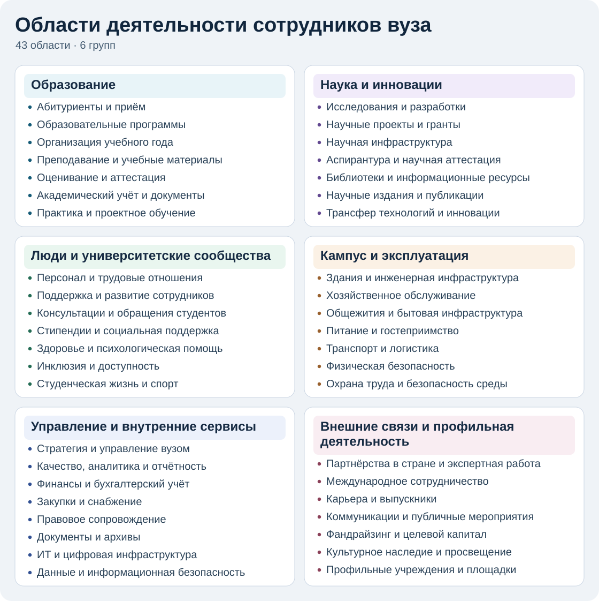

# Карта областей деятельности сотрудников вуза

Карта охватывает академическую, научную, административную, техническую и хозяйственную работу, университетские сервисы и профильные учреждения. Условия работы и поддержка самих сотрудников тоже входят в охват.

**Статус.** Исследовательская гипотеза о том, какие области стоит изучить. Открытые материалы вузов показывают примеры. Наличие и границы областей зависят от профиля и структуры конкретного университета.

[Открыть SVG в полном размере](areas.svg) · [Карта студенческих областей](../01-student-activity-map/map.md)

[Области и процессы сотрудников для LMS](lms-processes.md) — отобранные области, действия сотрудников и связь с задачами студентов.

## Образование

| Область | Что входит |
| --- | --- |
| Абитуриенты и приём | Довузовская ориентация, вступительные испытания, конкурсный набор и зачисление. |
| Образовательные программы | Программы разных уровней, учебные планы, дисциплины и дополнительное профессиональное образование. |
| Организация учебного года | Академический календарь, группы, расписание, аудитории и учебная нагрузка. |
| Преподавание и учебные материалы | Занятия, методика, учебные материалы и цифровая среда курса. |
| Оценивание и аттестация | Текущий контроль, обратная связь по работам, зачёты, экзамены и итоговая аттестация. |
| Академический учёт и документы | Контингент, образовательная траектория, академические статусы, ведомости, справки и документы об образовании. |
| Практика и проектное обучение | Учебная и производственная практика, прикладные проекты и базы практики. |

Открытые примеры. [Дирекция основных образовательных программ НИУ ВШЭ](https://www.hse.ru/deprog/about_dep) · [Структура и органы управления НИУ ВШЭ](https://www.hse.ru/sveden/struct/).

## Наука и инновации

| Область | Что входит |
| --- | --- |
| Исследования и разработки | Фундаментальные и прикладные исследования, эксперименты и разработки. |
| Научные проекты и гранты | Научные конкурсы, финансирование исследований, проектные обязательства и исследовательская этика. |
| Научная инфраструктура | Лаборатории, научное оборудование, центры коллективного пользования, полевые и экспериментальные базы. |
| Аспирантура и научная аттестация | Подготовка исследователей, научное руководство, диссертации и диссертационные советы. |
| Библиотеки и информационные ресурсы | Библиотечные фонды, читательские пространства, научные базы и электронные ресурсы для учёбы и исследований. |
| Научные издания и публикации | Университетские издательства, редакции журналов, рецензирование и научные публикации. |
| Трансфер технологий и инновации | Интеллектуальная собственность, внедрение разработок, технопарки, акселераторы и технологическое предпринимательство. |

Открытые примеры. [Научная деятельность ИТМО](https://science.itmo.ru/ru) · [Административные и сервисные подразделения ИТМО](https://itmo.ru/ru/department_units/administrativnye_podrazdeleniya.htm) · [Кампус МГУ](https://newcampus.msu.ru/).

## Люди и университетские сообщества

| Область | Что входит |
| --- | --- |
| Персонал и трудовые отношения | Штат, найм, кадровый учёт, условия занятости, рабочее время и трудовые отношения. |
| Поддержка и развитие сотрудников | Внутренние сервисы, адаптация, профессиональное развитие, льготы сотрудников и рабочая среда. |
| Консультации и обращения студентов | Информационная помощь, студенческая поддержка, обращения и обратная связь по услугам. |
| Стипендии и социальная поддержка | Стипендии, льготы, материальная помощь и социальные гарантии обучающихся. |
| Здоровье и психологическая помощь | Медицинская и психологическая поддержка университетского сообщества, профилактика и благополучие. |
| Инклюзия и доступность | Доступность обучения, рабочих мест, зданий и цифровых сервисов, адаптированные условия участия. |
| Студенческая жизнь и спорт | Студенческое самоуправление, объединения, волонтёрство, культурные инициативы и спорт. |

Открытые примеры. [Административные и сервисные подразделения ИТМО](https://itmo.ru/ru/department_units/administrativnye_podrazdeleniya.htm) · [Корпоративные сервисы ИТМО](https://edu.itmo.ru/ru/counseling/) · [Структура и органы управления НИУ ВШЭ](https://www.hse.ru/sveden/struct/).

## Кампус и эксплуатация

| Область | Что входит |
| --- | --- |
| Здания и инженерная инфраструктура | Недвижимость, помещения, строительство, ремонт, энергоснабжение и инженерные сети. |
| Хозяйственное обслуживание | Уборка, содержание территорий, обращение с отходами и хозяйственный инвентарь. |
| Общежития и бытовая инфраструктура | Жилой фонд, условия проживания, общие помещения и бытовые услуги. |
| Питание и гостеприимство | Столовые, кафе, организация питания и гостиничная инфраструктура при её наличии. |
| Транспорт и логистика | Транспорт вуза, парковки, перемещение грузов и внутренняя доставка. |
| Физическая безопасность | Охрана корпусов, пропускной режим, безопасность мероприятий и связь с экстренными службами. |
| Охрана труда и безопасность среды | Условия труда, пожарная и экологическая безопасность, готовность к чрезвычайным ситуациям. |

Открытые примеры. [Административные и сервисные подразделения ИТМО](https://itmo.ru/ru/department_units/administrativnye_podrazdeleniya.htm) · [Структура и органы управления НИУ ВШЭ](https://www.hse.ru/sveden/struct/) · [Кампус МГУ](https://newcampus.msu.ru/).

## Управление и внутренние сервисы

| Область | Что входит |
| --- | --- |
| Стратегия и управление вузом | Приоритеты, организационная структура, руководящие и коллегиальные органы, филиальная сеть. |
| Качество, аналитика и отчётность | Оценка качества, показатели, лицензирование и аккредитация, внутренний контроль и институциональная отчётность. |
| Финансы и бухгалтерский учёт | Бюджет, доходы и расходы, оплата обучения, расчёты с сотрудниками, бухгалтерский и управленческий учёт. |
| Закупки и снабжение | Потребности в товарах и услугах, закупочные условия, поставщики, поставки и материальное обеспечение. |
| Правовое сопровождение | Договоры, локальные акты, правовые вопросы, претензии и споры. |
| Документы и архивы | Делопроизводство, канцелярия, служебные документы, электронный документооборот и архивы. |
| ИТ и цифровая инфраструктура | Сети, рабочее оборудование, учётные записи, корпоративные системы, интеграции и техническая поддержка. |
| Данные и информационная безопасность | Доступ к информации, качество и хранение данных, защита персональных данных и безопасность систем. |

Открытые примеры. [Административные и сервисные подразделения ИТМО](https://itmo.ru/ru/department_units/administrativnye_podrazdeleniya.htm) · [Структура и органы управления НИУ ВШЭ](https://www.hse.ru/sveden/struct/) · [Дирекция основных образовательных программ НИУ ВШЭ](https://www.hse.ru/deprog/about_dep).

## Внешние связи и профильная деятельность

| Область | Что входит |
| --- | --- |
| Партнёрства в стране и экспертная работа | Связи с работодателями, академическими партнёрами, органами власти и регионом, прикладная экспертиза для внешних организаций. |
| Международное сотрудничество | Международные партнёрства, академическая мобильность, совместные программы, языковая и миграционная поддержка. |
| Карьера и выпускники | Карьерная поддержка, связи с работодателями, сообщества выпускников и профессиональные сети. |
| Коммуникации и публичные мероприятия | Сайт, медиа, бренд вуза, внутренние и внешние коммуникации, конференции и публичные события. |
| Фандрайзинг и целевой капитал | Пожертвования, благотворительные программы, внешняя поддержка развития и целевой капитал при его наличии. |
| Культурное наследие и просвещение | Музеи, коллекции, выставки, публичное просвещение и культурные программы. |
| Профильные учреждения и площадки | Специфичные для отдельных вузов клиники, учебные школы, театры, тренажёрные комплексы и учебно-опытные хозяйства. |

Открытые примеры. [Структура и органы управления НИУ ВШЭ](https://www.hse.ru/sveden/struct/) · [Кампус МГУ](https://newcampus.msu.ru/) · [Тренажёрный центр СПбГУ ГА](https://spbguga.ru/struct/drugie-podrazdeleniya/trenazhjornyj-tsentr/) · [Центр развития животноводства Тимирязевской академии](https://www.timacad.ru/unit/%D1%86%D0%B5%D0%BD%D1%82%D1%80-%D1%80%D0%B0%D0%B7%D0%B2%D0%B8%D1%82%D0%B8%D1%8F-%D0%B6%D0%B8%D0%B2%D0%BE%D1%82%D0%BD%D0%BE%D0%B2%D0%BE%D0%B4%D1%81%D1%82%D0%B2%D0%B0) · [О Санкт-Петербургской консерватории](https://conservatory.ru/about-conservatory) · [Целевой капитал ИТМО](https://fund.itmo.ru/ru/endaument/o-fonde).

## Основания карты

| Источник | Что помогло учесть |
| --- | --- |
| [Административные и сервисные подразделения ИТМО](https://itmo.ru/ru/department_units/administrativnye_podrazdeleniya.htm) | Научная инфраструктура, сервисы, ИТ и безопасность, кадры, финансы, закупки и хозяйственные подразделения. |
| [Корпоративные сервисы ИТМО](https://edu.itmo.ru/ru/counseling/) | Внутренние сервисы и профессиональное развитие сотрудников. |
| [Структура и органы управления НИУ ВШЭ](https://www.hse.ru/sveden/struct/) | Управление, студенческие и корпоративные сервисы, карьера, выпускники, внешние связи и кампус. |
| [Дирекция основных образовательных программ НИУ ВШЭ](https://www.hse.ru/deprog/about_dep) | Учебная организация, образовательные программы, документы и качество образования. |
| [Научная деятельность ИТМО](https://science.itmo.ru/ru) | Исследования, проекты и их сопровождение. |
| [Кампус МГУ](https://newcampus.msu.ru/) | Библиотека, музеи, издательство, школы и университетская клиника. |
| [Тренажёрный центр СПбГУ ГА](https://spbguga.ru/struct/drugie-podrazdeleniya/trenazhjornyj-tsentr/) | Пример профильной учебной инфраструктуры. |
| [Центр развития животноводства Тимирязевской академии](https://www.timacad.ru/unit/%D1%86%D0%B5%D0%BD%D1%82%D1%80-%D1%80%D0%B0%D0%B7%D0%B2%D0%B8%D1%82%D0%B8%D1%8F-%D0%B6%D0%B8%D0%B2%D0%BE%D1%82%D0%BD%D0%BE%D0%B2%D0%BE%D0%B4%D1%81%D1%82%D0%B2%D0%B0) | Пример учебно-производственной базы. |
| [О Санкт-Петербургской консерватории](https://conservatory.ru/about-conservatory) | Пример профильных театральных и концертных площадок. |
| [Целевой капитал ИТМО](https://fund.itmo.ru/ru/endaument/o-fonde) | Пример фонда, связанного с развитием университета. |
